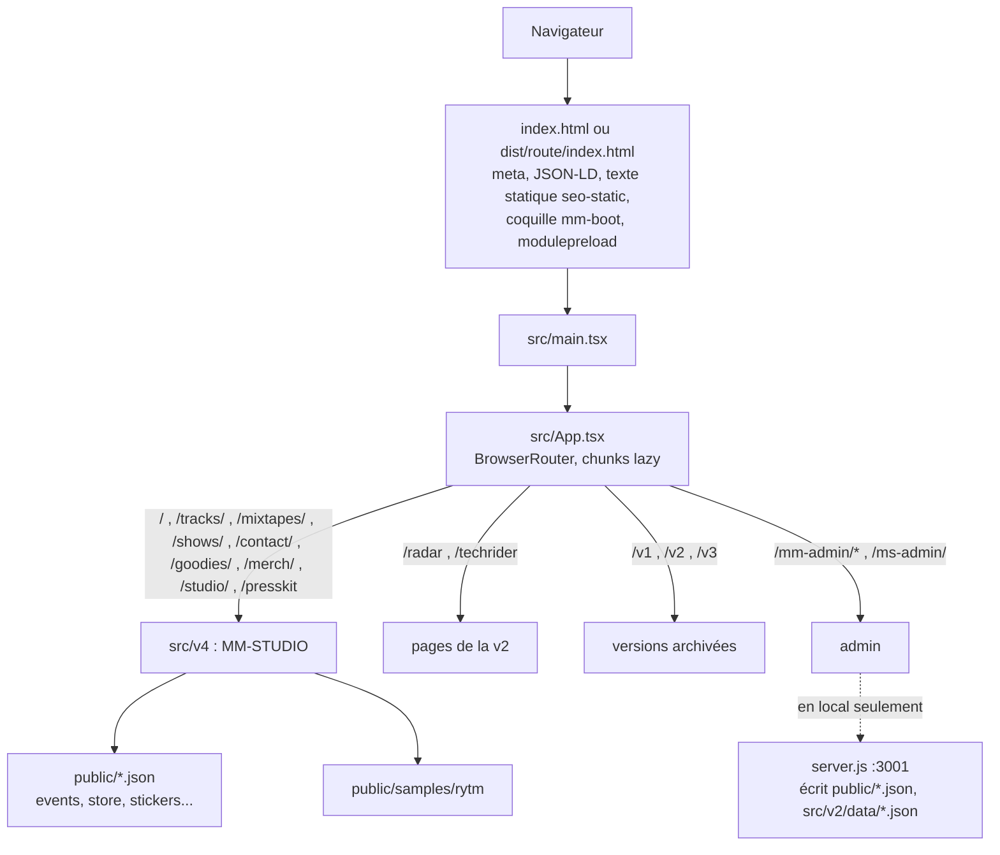
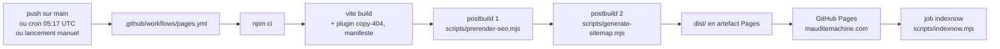
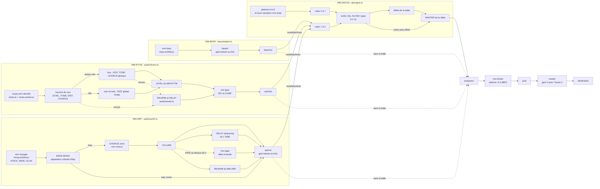

# Maudite Machine : mauditemachine.com

Le site de Mika, alias **Maudite Machine**, DJ et producteur (indie dance et dark disco), fondateur de VRSTL Records. La page d'accueil est **MM-STUDIO** : un studio en 3D qui se joue dans le navigateur, avec une boîte à rythmes (MM-RYTM), un synthé arpégiateur (MM-ARP), un générateur de basslines (MM-BASS, masqué par défaut) et des platines DJ avec leur table de mixage (MM-DECKS). Les sections du site (morceaux, mixtapes, dates, press kit, contact, boutique) s'ouvrent depuis la machine, et chacune a aussi une page HTML statique pour les moteurs de recherche.

- Site en ligne : https://mauditemachine.com
- Hébergement : GitHub Pages, 100 % statique. Aucun serveur en production.
- Langue de l'interface : anglais. Pages statiques supplémentaires en français (`/fr/`) et en espagnol (`/es/`).

Sommaire

1. [Démarrage rapide](#1-démarrage-rapide)
2. [Stack et architecture générale](#2-stack-et-architecture-générale)
3. [MM-STUDIO en détail](#3-mm-studio-en-détail)
4. [Le reste du site, les contenus et l'admin local](#4-le-reste-du-site-les-contenus-et-ladmin-local)
5. [Référencement](#5-référencement)
6. [Build et déploiement](#6-build-et-déploiement)
7. [Scripts npm et outils](#7-scripts-npm-et-outils)
8. [Conventions](#8-conventions)
9. [Sécurité et données](#9-sécurité-et-données)
10. [Arborescence](#10-arborescence)
11. [Pour aller plus loin](#11-pour-aller-plus-loin)

---

## 1. Démarrage rapide

### Prérequis

- Node.js 20 ou plus (le build de production tourne sur Node 20, le cron des stats sur Node 22 ; `scripts/fetch-stats.mjs` utilise `process.loadEnvFile`).
- npm (le dépôt a un `package-lock.json`, la CI fait `npm ci`).
- Pour les scripts de samples : macOS (`afconvert` convertit les AIFF), les fichiers de Mika étant sur son Mac.
- Pour le test de fumée, la référence MIDI et le banc du MM-ARP dans Chromium : Playwright et un Chromium, qui ne sont **pas** des dépendances du projet (chaque script dit dans son en-tête comment les trouver ou les installer).

### Commandes

```bash
npm install
npm run dev        # vite --open : http://localhost:5173
npm run admin      # vite + serveur d'écriture local (server.js, port 3001), ouvre /mm-admin
npm run build      # vite build, puis (postbuild) pages statiques SEO et sitemap
npm run preview    # sert dist/ en local (vite preview --open)
npm run smoke:v4   # test de fumée de MM-STUDIO, sans son
```

- `PORT=5174 npm run dev` change le port de vite (`server.port` dans `vite.config.ts`). Le navigateur s'ouvre quand même, parce que le script passe `--open`. Sans `--open` (`PORT=5174 npx vite`), `vite.config.ts` coupe l'ouverture automatique.
- `npm run admin -- --lan` ouvre l'admin au réseau local (iPad, téléphone). `server.js` refuse alors de démarrer sans `ADMIN_PASSWORD` (ou `ADMIN_API_KEY`). Le mode LAN de `server.js` s'active aussi par `ADMIN_LAN=1`, mais seul `--lan` ouvre aussi vite au réseau (`--host`).
- Pour travailler sur MM-STUDIO sans risque : ouvrir `http://localhost:5173/?debug=1&mute=1` (voir [3.9](#39-debug--drapeaux-durl-et-window__v4)).

### Avant de lancer un build en local

`npm run build` réécrit `dist/` et `public/sitemap.xml`, qui sont tous deux suivis par git, et écrit `indexnow-urls.txt` à la racine (ignoré par git). Il interroge aussi le site en ligne (`https://mauditemachine.com/seo-lastmod.json`, 8 s au plus) pour dater le sitemap ; `SEO_OFFLINE=1 npm run build` s'en passe (la date du jour partout).

Le `dist/` commité n'est **pas** ce qui est servi (la CI reconstruit tout à chaque push sur `main`) : le committer n'a aucun effet sur le site en ligne. Les commits récents ne le touchent plus (dernier commit de `dist/` le 2026-10-03) ; seul `deploy.sh` le remet d'accord (build local puis `git add -A`).

### Tests et vérifications (sans son)

Il n'y a ni tests unitaires, ni lint, ni vérification de types au build (TypeScript n'est pas une dépendance du projet : Vite transpile sans vérifier les types). Deux outils automatiques existent : `npm run smoke:v4` (depuis le 2026-10-21) et `npm run arp:bench -- --check` (depuis le 2026-10-22) :

- **`npm run smoke:v4`** (`scripts/smoke-v4.mjs`) : lance un serveur vite de dev sur un port libre, charge chaque machine (MM-RYTM, MM-ARP, MM-DECKS, MM-BASS avec `?bass=1`) en desktop (1440 x 900) et au téléphone (390 x 844, DPR 3, tactile, `?portrait=1`), attend la fin de l'intro et échoue (code 1) sur une exception de page, une erreur de console, une requête locale en échec ou en 4xx/5xx, l'absence de WebGL, une machine d'arrivée qui n'est pas la bonne, ou une racine `.v4-root` qui a défilé. Chromium tourne avec `--mute-audio`, chaque page avec `?mute=1`, le script ne touche ni RUN ni un pad, et les requêtes vers l'extérieur (analytics, SoundCloud, polices) sont bloquées. Options : `--url http://127.0.0.1:4173` (un `vite preview` déjà lancé, donc la prod), `--machines mm808,voy`, `--only desktop|phone`, `--settle`, `--timeout`.
- **`npm run arp:bench -- --check`** (`scripts/arp-bench.mjs`) : la non-régression du moteur du MM-ARP contre `scripts/arp-bench.golden.json` (voir [7](#7-scripts-npm-et-outils)).

Le reste se vérifie dans le navigateur, en muet, par le DOM et par `window.__v4` (voir [3.9](#39-debug--drapeaux-durl-et-window__v4)). Règle absolue du projet : **jamais de lecture audio réelle pendant un test** (le son sort sur les enceintes de Mika).

---

## 2. Stack et architecture générale

### Stack

| Couche | Outils |
|---|---|
| Front | React 18, TypeScript, Vite 5, React Router 7 |
| 3D | three 0.186 (imports nommés uniquement) |
| Audio | Web Audio API, 9 processeurs AudioWorklet maison (8 fichiers), 2 Web Workers |
| Style | CSS par version (`src/v4/v4.css`, `src/v2/v2.css`...), Tailwind 3 avec Preflight désactivé (`tailwind.config.ts`) |
| Animation (v1, v2) | framer-motion, gsap |
| Lecture SoundCloud | le widget SoundCloud, piloté par le moteur de la v2 (`src/v2/context/AudioPlayerContext.tsx`, `src/utils/scWidget.ts`) |
| Formulaire de contact | EmailJS (`src/data/emailjs.ts`), chargé seulement à l'envoi |
| Admin local et stats | Express 5 (`server.js`), multer (uploads), sharp (pochettes en WebP, aperçus et images des pages de motifs au prerender), recharts (dashboard des stats), @dnd-kit (tri de la discographie) |
| Mesure | GA4 (gtag) et Meta Pixel, chargés après le `load` (`index.html`) ; événements GA4 de la machine (`src/v4/state/analytics.ts`) |
| Hébergement | GitHub Pages, build dans GitHub Actions, IndexNow après un déploiement qui change des adresses |

### Vue d'ensemble





### Routes (`src/App.tsx`)

| Adresse | Ce qui s'affiche | Fichier |
|---|---|---|
| `/` | MM-STUDIO | `src/v4/index.tsx` |
| `/tracks/`, `/tracks/<morceau>/`, `/mixtapes/`, `/shows/`, `/contact/` | MM-STUDIO, la section ouverte dès le montage, sans intro | `src/v4/state/sectionRoute.ts` |
| `/goodies/`, `/merch/`, `/studio/` | MM-STUDIO, la section ouverte après l'intro (ce sont les puces du capot) | idem |
| `/presskit` | MM-STUDIO et la visionneuse du press kit par-dessus | `src/v4/ui/PresskitViewer.tsx` |
| `/radar` | Radar des sorties (page de la v2) | `src/v2/pages/RadarPage.tsx` |
| `/techrider` | Fiche technique (page de la v2) | `src/v2/pages/TechRiderPage.tsx` |
| `/v1/*` | v1 archivée (noindex) | `src/components/Layout.tsx`, `src/pages/*` |
| `/v2` | v2 archivée (site principal d'août à septembre 2026) | `src/v2/V2App.tsx` |
| `/v3` | expérience ACID LINE, hors sitemap | `src/v3/V3App.tsx` |
| `/mm-admin/*` | admin local (consultation seule en ligne) | `src/admin/AdminApp.tsx` |
| `/mm-admin/stats` | dashboard des stats | `src/pages/AdminStatsPage.tsx` |
| `/mm-admin/radar` | radar admin (garde le Layout v1 pour son lecteur) | `src/pages/AdminRadarPage.tsx` |
| `/ms-admin/` | ancien admin des messages (v1) | `src/components/Admin.tsx` |
| `/v4`, `/about`, `/archives`, `/v2/radar` | redirections (dans le routeur, et une page de redirection statique écrite au build) | `src/App.tsx`, `scripts/prerender-seo.mjs` |
| toute autre adresse | page 404 | `src/pages/NotFoundPage.tsx` |

Une adresse de morceau en majuscules est ramenée en minuscules. Une adresse de morceau inconnue ouvre TRACKS, revient à `/tracks/`, et TRACKS dit au-dessus de la liste que le morceau est introuvable.

Hors routeur React, servies telles quelles :

- `/press/` : page statique `public/press/index.html` (le plugin `serve-press-index` de `vite.config.ts` la sert aussi en dev).
- `/fr/`, `/es/` et les 45 pages `/mm-studio/...` (EN, FR, ES : le hub, les trois machines, le hub des motifs et dix styles) : HTML simple généré au build par `scripts/prerender-seo.mjs`, sans le bundle React (voir [5](#5-référencement)).
- `/qr/` (`public/qr/index.html`, la cible des stickers), `/soundcloud-connect.html` (retour de la connexion SoundCloud du MM-DECKS).

---

## 3. MM-STUDIO en détail

Tout MM-STUDIO vit dans `src/v4/` (environ 117 000 lignes, dont 108 000 de TypeScript et de JavaScript et près de 9 000 de CSS, chargées en chunks lazy : la v1 et la v2 n'en téléchargent rien). La spécification d'ingénierie est `docs/v4/spec.md` (en anglais, numérotée R14-xxx pour les évolutions, dernière entrée R14-289 du 2026-10-19). Les corrections de l'audit des 2026-10-21 et 22 sont décrites dans les commentaires datés du code (avec leur repère d'audit : RS-1, F2, P8, RA1-1...) et dans les messages de commit.

Noms internes et noms affichés :

| Nom affiché | Id interne | Dossiers principaux |
|---|---|---|
| MM-RYTM | `mm808` (ancien nom : MM-808) | `src/v4/audio/`, `src/v4/rytm/`, `src/v4/scene/` |
| MM-ARP | `voy` (ancien nom : MM-VOYAGER) | `src/v4/voyager/`, `src/v4/audio/synth.ts`, `src/v4/audio/moog.worklet.js` |
| MM-BASS | `bass` | `src/v4/bass/` |
| MM-DECKS (MM-MIXER au téléphone tenu droit) | `dj` | `src/v4/dj/`, `src/v4/sampler/` |

Sur la table, de gauche à droite : MM-RYTM, MM-BASS (si présent), MM-ARP, MM-DECKS (`MACHINES` dans `src/v4/state/focus.ts`).

### 3.1 Démarrage, montage et cycle de vie

- **Coquille de démarrage** (2026-10-21) : `scripts/prerender-seo.mjs` pose dans le HTML des pages de la machine (accueil, sections, morceaux ; jamais `404.html` ni les pages React de la v2) une coquille `#mm-boot` en style en ligne (le logo, le titre de la page, une ligne, une barre qui avance ; crème si l'apparence retenue est Light), peinte avant le moindre script, et les `modulepreload` du chunk de la machine et de three, lus dans le manifeste de vite (`build.manifest` dans `vite.config.ts`, retiré de `dist/` ensuite). `src/v4/state/boot.ts` l'efface en fondu à la première image de la scène, au repli sans WebGL ou à l'arrivée par un panneau ; `StaticContentGuard` (`src/App.tsx`) la retire à une navigation vers une autre page ; `index.html` la cache sans JavaScript (`noscript`). Ce qui peut attendre (le préchauffage des WAV du MM-RYTM, les photos du hoodie du menu) part après cette première image. Mesure du 2026-10-21 en 4G lente simulée : premier affichage de l'accueil au téléphone de 3,9 s à 0,9 s.
- `src/main.tsx` monte `App` et écoute `beforeinstallprompt` dès le départ (`src/v4/state/install.ts`).
- `V4App` (`src/v4/index.tsx`) relit les drapeaux d'URL (`syncFlags`), enveloppe tout dans le moteur SoundCloud de la v2 (`EngineProvider`, `src/v4/engine.ts`) et monte `V4Shell`.
- `V4Shell` crée le `Stage` (la scène, `src/v4/scene/renderer.ts`) dans `.v4-canvas-host`, puis superpose les couches HTML : couche de saisie (`HitLayer`), jumeaux accessibles (`Twins`, `VoyTwins`, jumeaux du MM-DECKS et du MM-BASS), écran accessible (`Lcd`), en-tête, panneau des sections, Dock du téléphone, éditeurs, cartes INFOS, oscilloscope.
- Le code du MM-DECKS et du MM-BASS arrive dans des chunks séparés, après le chargement principal (`src/v4/state/djload.ts`, `src/v4/state/bassload.ts`). La visionneuse du press kit aussi.
- Le contexte audio n'est **jamais** créé au montage : le premier `pointerdown` ou `keydown` de la page appelle `gesture()` (`src/v4/actions.ts`), qui le crée ; `pointerup` et `touchend` le relancent (règle iOS). Le premier geste termine aussi l'intro.
- **Onglet caché** : le rendu dort ; le son s'endort aussi si rien ne joue. Depuis le 2026-10-21, une machine ou une platine qui s'arrête pendant que l'onglet est caché (un morceau fini, un STOP du Roto) endort le contexte deux secondes plus tard s'il ne joue plus rien (`onPlayStop` de `state/playLock.ts`, `index.tsx`) ; un RUN dans ces deux secondes l'annule. Une autre fenêtre devant ne coupe pas la musique.
- La racine `.v4-root` expose son état en attributs `data-v4-*` (state, gl, layout, motion, muted, intro, instrument, bpm, running, section, sc, exploded, view, theme, iosbar, focus) : c'est ce que les tests lisent.
- Une erreur de rendu ou une perte de contexte WebGL bascule sur la page de repli (`StageBoundary`, `onContextLost`), jamais sur un écran vide.
- Au démontage : l'horloge s'arrête, la queue de reverbe est jetée (`quiet`), le contexte s'endort (`suspend`), le motif en attente est écrit (`pattern.flush`). Un remontage de la page ne garde plus l'ancienne en mémoire.

### 3.2 La scène 3D (`src/v4/scene/`)

- **Stage** (`scene/renderer.ts`) : un `WebGLRenderer` sur son propre canvas, une caméra perspective (fov 30 deg) posée par une orbite maison, des lumières fixes dans le monde, un sol qui ne reçoit que l'ombre (`scene/floor.ts`). La boucle est **à la demande** : une image seulement si quelque chose a changé, zéro image au repos, rien quand l'onglet ou le canvas est caché. La carte d'ombre n'est refaite que si un objet qui projette une ombre a bougé. Pendant la lecture, la boucle lit l'horloge audio à chaque rAF mais ne rend qu'au changement de pas.
- **Orbite** (`scene/orbit.ts`) : glisser pour tourner (élévation bornée), molette et pincement pour zoomer. Au doigt, un seul doigt ne tourne jamais la vue (il reste aux potards, pads et pas), deux doigts tournent et pincent. RESET VIEW, la touche R ou une double tape du fond ramènent la vue par défaut (`state/view.ts`).
- **Machines** : le corps du MM-RYTM (`scene/machine.ts`, chassis en coin façon Elektron, panneau incliné), sa sérigraphie (`scene/silk.ts`), son écran (`scene/screen.ts`, une texture canvas dessinée à la façon de l'OP-1), ses encodeurs (`scene/encoders.ts`), pads (`scene/pads.ts`), touches de pas (`scene/sequencer3d.ts`), PCB (`scene/pcb.ts`) et face arrière (`scene/backplate.ts`). Les autres machines ont leur « rig » : `voyager/rig.ts`, `bass/rig.ts`, `dj/rig.ts`, que le Stage pose à droite du MM-RYTM, anime et alimente en survol. Les objets qui bougent ou changent de couleur un par un sont des `InstancedMesh` ; ce qui ne bouge jamais est fusionné. Les écrans (RYTM, ARP et sa séquence, BASS, DECKS) ont un reflet de verre et se redessinent quand les polices SF Pro arrivent.
- **OPEN, la vue éclatée** (`scene/explode.ts`, `state/explode.ts`) : le panneau se soulève, le PCB sort du chassis. Sous le capot : les TWEAKS soudés sur la carte (`scene/tweakplate.ts`, `scene/rytmTweaks.ts`, `voyager/tweaks.ts`, `bass/tweaks.ts`), les puces GOODIES, MERCH et STUDIO du MM-RYTM, l'oscilloscope (`ui/Scope.tsx`) et les cartes INFOS (`rytm/infos.ts`, `voyager/infos.ts`, `bass/infos.ts`). Le séquenceur n'est jamais touché : la musique continue.
- **Picking** (`scene/hit.ts`) : pas de `Raycaster`. Chaque objet interactif est déclaré dans une liste explicite (une boîte ou un cylindre dans le repère de son calque) ; sa silhouette projetée en pixels est sa forme de clic. Le test ne tourne qu'aux événements de pointeur ; des occulteurs déclarés cachent ce qui est derrière. Au doigt, un point hors de toute forme compte encore à moins de 24 px d'un objet visible.
- **Couche de saisie** (`ui/Hotspots.tsx`) : un seul élément transparent reçoit les pointeurs. Un objet ne part qu'au relâchement, si le pointeur a bougé de moins de 6 px et que le relâchement tombe sur le même objet ; un glisser fait tourner la machine. Un glisser parti d'un encodeur le tourne et ne fait jamais orbiter la vue.
- **Jumeaux HTML** (`ui/Hotspots.tsx`, `ui/VoyTwins.tsx`, `dj/Twins.tsx`, `bass/Twins.tsx`) : chaque objet 3D a un vrai bouton, lien ou slider HTML posé sur sa projection (recalculée à chaque image rendue où la vue a bougé). Clavier et lecteurs d'écran passent par eux ; `ui/Lcd.tsx` est le jumeau `aria-live` de l'écran. Les jumeaux cachés du MM-DECKS sont inertes.
- **Apparence** Dark ou Light (`state/appearance.ts`) : changer d'apparence, ajouter ou retirer une platine reconstruit la scène. Avant chaque reconstruction, `reserve(3)` programme trois secondes de musique d'avance : la scène peut geler l'image, pas le son.

### 3.3 Le graphe audio

Un seul `AudioContext` pour toute la page, créé au premier geste (`ensure()` dans `src/v4/audio/drums.ts`, `latencyHint: 'balanced'`). Chaque machine sort par sa propre prise ; la table du MM-DECKS peut les reprendre sur ses voies 1 à 3.



Points à connaître :

- **Le kick a sa propre voie** (`kickBus`) : il ne reçoit que le DIST et le TONE globaux, jamais le CHORUS, le DELAY ni la REVERB globaux (le « kick doublé » du 2026-10-08). Il est aussi monophonique : un kick coupe la queue du précédent en 3 ms. Il reste la référence de niveau : caisse claire, clap et toms juste sous lui (crête et sonie).
- **Inserts en bypass réel** : à leur valeur neutre, TONE, DIST, CHORUS sont court-circuités et un envoi à 0 est débranché. Au repos, une voix ne traverse que des gains à 1.
- **Effets du MM-RYTM après l'audit des 2026-10-21 et 22** :
  - DELAY (`audio/sends.ts`) : les filtres de la boucle prennent leur Q en dB (Butterworth à -3,01 dB, `BUTTER_Q_DB`) : la boucle ne dépasse plus jamais sa réinjection (0,87 au plus), le DELAY à fond ne s'emballe plus. L'unité s'arrête quand sa queue est 100 dB sous son départ (8 s au moins, sortie effacée en 50 ms) ; un nouveau TIME ou un nouveau tempo passe d'une lecture à l'autre en fondu de 60 ms.
  - CHORUS (`audio/chorus.ts`) : chaque ligne ne retarde que son canal (une voix placée par PAN reste à sa place), le sec et le mouillé baissent ensemble avec le réglage (à 100 %, une voix ne sort plus 7 à 8 dB plus fort), une branche neuve se remplit 45 ms en silence avant de glisser. Il passe toujours au worklet `mm-chorus` : une branche bâtie avant le module (en `DelayNode`) est échangée dès qu'il est là, sans clic.
  - TONE et sa RESO : Q en dB, passe-bande compensé (`bandGain` de `audio/voicefx.ts`, Q^0,2 : +4,9 dB à fond), une bande résonante sur un tom ne passe plus au-dessus du kick.
  - Tourner un FX ne reprogramme plus tous les coups à venir : seuls SWING et les réglages qu'un coup lit le font. Les verrous (P-locks) d'envoi, de DIST et de CHORUS sont posés en rampe, sans marche ni creux.
- **Routage** : `routeMachines()` (`audio/drums.ts`) bascule les prises `rytmOut`, `bassOut` et `arpOut` vers les voies 1 (MM-RYTM), 2 (MM-BASS) et 3 (MM-ARP) de la table, la nouvelle prise branchée avant de débrancher l'ancienne (pas un instant sans son). C'est `dj/actions.ts` qui l'appelle quand le moteur du MM-DECKS se crée (`djWake`, après le premier geste). Sans moteur de table, les prises vont droit à l'analyseur. L'écran du MIXER (et celui d'une machine à son RUN) dit en orange quand la table baisse une machine (`MASTER -INF`, `1 RYTM -INF`, `2 ARP LPF FX` : `stripNote` et `masterNote` de `dj/actions.ts`).
- **Table au repos** (`dj/engine.ts`, 2026-10-21) : l'isolateur et le filtre d'une voie ne sont branchés que tournés, un VU se débranche 1,5 s après sa dernière lecture, un effet à zéro est débranché. OVERDRIVE garde le niveau ; DELAY TRANS et FLANGER suivent le tempo des machines.
- **SIDECHAIN** : `audio/duck.ts` baisse le gain de `arpOut` et de `bassIn` à chaque kick, calé sur ce que le kick joue.
- **Limiteur** : `audio/limiter.worklet.js`, à anticipation de 3 ms, stéréo lié, plafond -0,3 dBFS. Depuis le 2026-10-21, sa somme glissante est en double précision (un résidu en float32 laissait passer +60 dBFS sous un delay emballé) et le plafond est tenu à l'échantillon. Tant qu'il n'est pas chargé (ou sans AudioWorklet), un écrêteur doux suréchantillonné 4x le remplace.
- **`?mute=1`** : le gain `master` est posé à 0 avant tout branchement et ne reçoit jamais d'automation. L'analyseur, le limiteur et `post` sont avant lui : le signal reste mesurable sans rien envoyer aux enceintes.
- **Prises de mesure** : l'oscilloscope (`audio/scope.ts`, worklet `mm-scope`) écoute `rytmOut`, `arpOut`, la sortie de la tranche du kick et `post` (`scopeTaps()`). La mémoire du MIXER (`sampler/ring.ts`, worklet `mm-ring`, 34 s) et le vumètre master de la table écoutent `post`.
- **SoundCloud** : les morceaux de TRACKS et MIXTAPES passent par le widget SoundCloud (iframe cachée), hors du graphe Web Audio. Une piste qui démarre met le MM-RYTM en STOP, arrête l'arpège du MM-ARP et la séquence du MM-BASS, et met les platines en pause (`audio/soundcloud.ts`, `bass/actions.ts`, `dj/actions.ts`). RUN met la piste en pause.

AudioWorklets (tous des fichiers `*.worklet.js`, jamais inlinés : `build.assetsInlineLimit` dans `vite.config.ts`, car Safari peut refuser un module en `data:` URL) :

| Processeur | Fichier | Rôle |
|---|---|---|
| `mm-glue` | `src/v4/audio/glue.worklet.js` | BIT (réduction de bits et d'échantillonnage) et COMP (compresseur de bus) du MM-RYTM |
| `mm-limiter` | `src/v4/audio/limiter.worklet.js` | limiteur de sortie du site |
| `mm-chorus` | `src/v4/audio/chorus.worklet.js` | chorus à retard modulé (bus et voix du MM-RYTM, Juno-106 du MM-ARP), interpolation sinc |
| `mm-tape` | `src/v4/audio/chorus.worklet.js` | délai à bande du TWEAK TAPE du MM-ARP : le trajet du ping-pong, tête qui pleure (0,55 Hz) et scintille (6,5 Hz), saturation et répétitions plus sombres dans la boucle |
| `mm-voyager` | `src/v4/audio/moog.worklet.js` | moteur du MM-ARP (voir [3.5](#35-les-machines)) |
| `mm-bass` | `src/v4/bass/bass.worklet.js` | voix monophonique du MM-BASS, filtre d'après Open303, mode MONARK |
| `mm-smpl` | `src/v4/sampler/sampler.worklet.js` | sampler d'une platine : slices, grains, time-stretch |
| `mm-ring` | `src/v4/sampler/ring.worklet.js` | mémoire circulaire de la sortie (REC MIX) |
| `mm-scope` | `src/v4/audio/scope.worklet.js` | prise de l'oscilloscope, à l'échantillon près |

Web Workers : `src/v4/audio/shots.worker.ts` (calcul des one-shots du MM-RYTM) et `src/v4/dj/grid.worker.ts` (tempo et grille des temps d'un morceau).

### 3.4 Horloge et ordonnancement

- `src/v4/audio/clock.ts` : séquenceur du MM-RYTM, ordonnancement par anticipation sur l'horloge **audio**. Un `setInterval` de 25 ms réveille l'ordonnanceur, qui programme chaque pas tombant dans l'horizon. La grille est exacte (`ancre + n x durée du pas`), jamais une somme de pas. SWING retarde les pas pairs sur le temps programmé lui-même.
- `src/v4/audio/sched.ts` : l'horizon commun à tous les ordonnanceurs, 300 ms (450 ms sur pointeur grossier). Chaque changement (pas, mute, potard, tempo, swing, accord) annule et reprogramme tout de suite ce qui n'a pas encore sonné, au-delà d'une garde de 30 ms (`GUARD_S`). `reserve(s)` programme `s` secondes d'avance avant un gros travail connu du fil principal. Un pas raté de plus de 50 ms est sauté, pas rattrapé en rafale.
- Les autres ordonnanceurs utilisent la même technique et suivent la grille du MM-RYTM s'il joue : l'arpégiateur (`voyager/arp.ts`), la séquence du MM-BASS (`bass/seq.ts`), la séquence du sampler de chaque platine (`sampler/seq.ts`, qui suit d'abord sa platine). La sortie MIDI du MM-ARP (`midi/noteout.ts`) se cale sur cette garde : voir [3.7](#37-midi-roto-control-et-midi-out-srcv4midi).
- Le rendu (LED, pads, Dock) suit la position **audio** (`state/playhead.ts`), pas l'instant de programmation.
- Tempo : 100 à 150 BPM, 130 au départ (`BPM` dans `audio/pattern.ts`).

### 3.5 Les machines

#### MM-RYTM, la boîte à rythmes

- Huit voix : BD, SD, CH, OH, CP, TOM, HT, CY (`INSTRUMENTS`, `audio/pattern.ts`), 16 pas avec vélocité.
- Deux couches par voix (`audio/kit.ts`) : SYNTH (synthèse façon 909, 808 ou MM, calculée par `audio/shotsdsp.ts` dans un worker) et SAMPLE (les samples de Mika dans `public/samples/rytm/<famille>/`, listés au build par le module virtuel `virtual:rytm-samples` de `vite.config.ts`, plus les samples déposés par le visiteur, gardés dans son navigateur par `audio/usersamples.ts`).
- Les coups sont pré-calculés hors du fil principal (`audio/shots.ts`) : jamais de calcul pendant la lecture. Un coup pas prêt prend le **même son** à une autre hauteur, un autre STRETCH, une autre variante ou fréquence ; sinon le son précédent de la voix (`lastPlayed`) ; sinon le repli. Un nouveau choix de son se calcule tout de suite, en tête de file ; un potard SOUND qui balaie la liste (moins de 100 ms entre deux crans) ne charge et ne calcule que le cran où il s'arrête. Le cache des coups a un budget (96 Mo sur ordinateur, 40 Mo au téléphone, 240 entrées, LRU) ; une exception du worker est retentée une fois puis le repli joue, un worker qui plante est relancé.
- **Chargement des samples** (`audio/samples.ts`, 2026-10-21 et 22) : un état par sample, `idle`, `loading`, `ready` ou `failed` avec sa raison (`offline` : réseau coupé, serveur en panne ou rien reçu depuis 8 s ; `missing` : 404 ; `bad` : illisible ; `storage` : base du navigateur fermée ; `gone` : retiré de ce navigateur).
  - Un seul chargement par clé ; le délai de 8 s (`FETCH_TIMEOUT_MS`) est un délai d'**inactivité**, réarmé à chaque morceau reçu : un téléchargement lent qui avance n'est plus coupé.
  - `offline` et `storage` se retentent seuls après 1 s, 4 s et 15 s (`RETRY_MS`), puis toutes les 10 s tant que le kit (ou un pas verrouillé) joue ce sample, et dès que le réseau revient (événement `online`) ; `missing` une seule fois de plus ; `bad` et `gone` jamais. Un choix explicite (navigateur des sons, potard SOUND, preset) retente tout de suite un échec passager.
  - Repli (`synthFallback` de `audio/kit.ts`) : la couche SYNTH de la voix seule, à son plein niveau, quand le sample est en échec ou en chargement sans son précédent. L'écran le dit : `LOADING...` tant qu'il arrive, `OFFLINE: 909 PLAYS` (ou `FILE MISSING`, `FILE ERROR`, `STORAGE OFF`, `REMOVED`) quand il n'a pas pu venir, une fois par choix ; revenu, `<VOIX> <NOM> LOADED`.
  - Les PCM décodés tiennent dans un budget (`PCM_BUDGET` : 160 Mo sur ordinateur, 48 Mo au téléphone ; le moins récemment servi part d'abord, jamais un sample que le kit joue) et se rechargent à la demande.
- **Fichiers du visiteur** (`audio/usersamples.ts`, `audio/audiofile.ts`) : un fichier déposé ou choisi (wav, aif, aiff, aifc, mp3, flac, m4a ; 10 Mo et 12 s au plus, 60 par famille) est lu sans risque. `probeAudio` lit le format et la durée dans l'en-tête **avant** tout décodage (WAV compté en trames, avec un en-tête faux refusé avant décodage ; AIFF ; FLAC par STREAMINFO ; MP3 par la trame Xing, Info ou VBRI, sinon une estimation par le débit de la première trame ; M4A ; OGG), `decodeAiff` lit l'AIFF et l'AIFC non compressés que Chrome et Firefox refusent, `cleanPcm` met les NaN et Inf à 0 et borne à +12 dB. Un fichier muet est refusé (`SILENT FILE`), comme `TOO BIG`, `TOO LONG`, `NOT AUDIO`, `TOO MANY`, `STORAGE OFF`. Un coup de sample ne dépasse jamais 16 s. Des fichiers ajoutés d'un coup : seul celui qui joue garde son son décodé.
- Écran et pages façon Digitakt : VOICE, FLTR, ENV, FX (`rytm/pages.ts`, `rytm/pageView.ts`, `state/rytmPage.ts`), huit encodeurs de page, navigateur des sons (`state/lcdSamples.ts`). MASTER et TEMPO sont dessinés dans l'écran (`state/screenDials.ts`). L'en-tête de la vue PAGE a des places fixes.
- Les huit potards de la face suivent la page (desktop, 2026-10-27, comme une Digitakt) : le potard k (A à D en haut, E à H dessous), le bloc posé dans la case k de l'écran et la cible MIDI `rytm:knob:k+1` sont une seule fonction (`rytm/pages.ts` `faceBlockOf`, loi `FACE_LAW` : `mirror` par défaut, `cell` rend l'écran d'avant). Un potard ne change jamais de page ; sous HOME, le premier toucher montre la page ; la touche de page allumée pressée encore passe à sa deuxième page de huit (VOICE puis SYNTH, FX : ses deux onglets). Les anneaux et les capuchons lisent `rytm/faceKnobs.ts` (les huit vues, leur cause : page, voix, P-LOCK, potard, valeur) ; les capuchons vont à leur valeur comme des potards motorisés (60 à 220 ms), les anneaux sautent. La sérigraphie dit A à H, l'écran dit la fonction. Les cibles `rytm:enc:*` restent les FX globaux. Au téléphone, les huit potards restent les FX globaux (phase 5).
- Réglages et effets par voix (`audio/voicefx.ts` : LEVEL, TONE, DECAY, TUNE, PAN, START, filtre et enveloppe des pages FLTR et ENV, DIST, REVERB, DELAY, CHORUS avec RATE, DEPTH et TONE) et effets globaux (SWING, STRETCH, DIST, CHORUS, DELAY, REVERB, BIT, COMP).
- Parameter locks par pas (`audio/locks.ts`, `state/rytmLock.ts`), y compris les « sample locks ».
- 16 patterns A01 à A16 et une chaîne, comme le chain mode d'une Digitakt (`state/patterns.ts`). MUTE et SOLO (`state/voices.ts`), RANDOM, CLEAR (qui rend un son à une voix laissée muette, sans jamais remplacer un sample choisi).
- Dix styles d'usine (`RYTM` dans `state/factory.ts` : ACID, DARK DISCO, INDIE DANCE, MINIMAL, ROLLING, TECHNO, HOUSE, ELECTRO, EBM, ITALO), lus aussi au build par les pages de motifs (voir [5.3](#53-les-pages-mm-studio-et-les-pages-de-motifs)).
- Éditeur EDIT (motif et vélocités) : `ui/BeatEditor.tsx`. Au téléphone, le Dock (`ui/Dock.tsx`, page KNOBS : `ui/KnobPanel.tsx`).

#### MM-ARP, le synthé arpégiateur

- **Moteur** : `audio/moog.worklet.js` (processeur `mm-voyager`), calculé échantillon par échantillon, piloté par `audio/synth.ts` :
  - deux oscillateurs à formes morphables (sinus, triangle, dent de scie, carré, impulsion ; OSC 1 finit sur la FM) et un SUB, sans repliement (PolyBLEP), une vraie PWM entre SQUARE et PULSE, SYNC et FM propres (BLEP à la remise de phase) ;
  - filtre en échelle 24 dB avec saturation dans chaque étage, ses pentes recalculées à chaque échantillon suréchantillonné (plus de repliement autour de 48 kHz) ; la résonance chante plus tôt (auto-oscillation dès RES 0,9) ;
  - deux ADSR, GLIDE, LFO MOD calé sur la mesure, DRIFT (dérive lente, gigue, étalonnage par voix) ;
  - bloqueurs de continu sur la branche OVERDRIVE (20 Hz) et en sortie du moteur (8 Hz), OVERDRIVE compensé (il chauffe sans monter de 6 dB), écrêteur doux de sortie (genou à -6 dBFS, jamais au-dessus de -3 dBFS) ;
  - suréchantillonnage x4 sur ordinateur, x2 au téléphone, retour par filtres demi-bande de Kaiser ; 12 voix sur ordinateur, 8 au téléphone (une voix en fin de relâchement s'éteint sous -66 dB ; la voix volée est la plus discrète) ;
  - **STACK** (2026-10-22) : chaque oscillateur en deux ou trois exemplaires désaccordés (3 à 30 cents), à sonie égale ; trois au bureau, deux au téléphone ;
  - **WIDE** : un second filtre par voix pour la droite, les exemplaires de STACK (sans STACK : OSC 1 et OSC 2, selon leur puissance) partagés entre gauche et droite ; huit notes au plus sur ordinateur, quatre au téléphone ;
  - **GLUE** : compresseur lié stéréo doux (2:1, genou 8 dB, rattrapage automatique) puis arrondi des crêtes (anti-repliement ADAA), à sonie quasi égale ;
  - **ACC FILTER** : l'accent ouvre aussi le filtre, façon 303 ;
  - un vrai relâchement (message `noteOff`) pour une note jouée sans fin, comme sous un clavier MIDI ou un clip d'Ableton ;
  - un hasard à graine (`processorOptions.seed`, mulberry32) : la base des tests de non-régression et du futur plugin.
  STACK, WIDE et GLUE à 0 rendent au bit près le moteur du 2026-10-21 (vérifié par `npm run arp:bench -- --against`).
- **Chaîne d'effets** (`audio/synth.ts`) : BASS MONO (séparation Linkwitz-Riley), CHORUS Juno (`mm-chorus`), VOLUME, DELAY ping-pong ou bande (TAPE), REVERB. **DLY TIME** règle le temps du DELAY (1/8, 3/16 au départ, 1/4, 3/8, 1/2) ; un changement de DLY TIME ou de tempo glisse comme une bande (la tête lit entre 0,75x et 1,25x, jamais à l'envers). **TAPE** au-dessus de 0 envoie le DELAY dans le délai à bande `mm-tape` ; les échos déjà partis finissent dans les `DelayNode`.
- Un moteur qui ne se charge pas est retenté à la note suivante après 1, 3 puis 10 s, ou tout de suite au prochain geste, et l'écran le dit (`NO SOUND, TAP TO RETRY` ; une version plus récente en ligne : `NEW VERSION, RELOAD`).
- Potards et leur traduction en son : `voyager/params.ts` (`VOY_KNOBS`, chaque réglage avec sa valeur de départ et sa valeur d'héritage `legacy` : un son gardé d'avant l'arrivée d'un réglage le reprend à la valeur qui ne change rien). Huit pads d'accords, tous en fa dièse mineur (`voyager/chords.ts`) ; un pad touché entre dans la progression, un accord par mesure.
- Arpégiateur : `voyager/arp.ts` (RATE, MODE, RANGE, NOTES, GATE, OCTAVE). Suite AUTO ou EDIT, modifiable note par note : `voyager/seq.ts`, éditeur `ui/SeqLane.tsx`.
- Grand écran : `voyager/screen.ts`. Quinze TWEAKS sous le capot (`voyager/tweaks.ts`), en quatre groupes OSCILLATORS, OUTPUT, PERFORMANCE et DELAY (`voyager/theme.ts`) : PHASE, DRIFT, STACK, SYNC, WIDTH, WIDE, BASS MONO, GLUE, SIDECHAIN, KEY TRACK, ACCENT, ACC FILTER, CHORD, DLY TIME, TAPE. Au téléphone : `ui/VoyDock.tsx` (potards et pads se prennent aussi par leur nom). Sur ordinateur, les réglages de l'arpégiateur sont en fiche (nom à gauche, valeur à droite).
- Dix-neuf presets d'usine (`ARP` dans `state/factory.ts` : les dix styles, puis NIGHT DRIVE, HYPNO LOOP, INDIE PULSE et ACID NIGHT, ajoutés pendant l'audit, puis MS SCREAM, MONARK DRIVE, SPACE INDIE, MS HYPNO et RES PING, choisis par Mika le 2026-10-26 après l'écoute du contrôle qualité : le MS-10, LOAD et SPACE ; ids `factory-arp-0` à `18`, toujours ajoutés à la suite), tous avec GLUE depuis le 2026-10-22, TAPE sur tous sauf ELECTRO et EBM (délai net, `tape: 0`), WIDE et STACK sur ceux qui en profitent, VOLUME recalé pour la même sonie.
- Sortie MIDI vers Ableton : voir [3.7](#37-midi-roto-control-et-midi-out-srcv4midi). Étude du portage en plugin VST3 / AU : `docs/vst3/2026-10-21-etude-mm-arp-vst3.md`.

#### MM-BASS, le générateur de basslines (masqué par défaut)

- Caché depuis le 2026-10-10 (Mika veut se concentrer sur RYTM et ARP) : `?bass=1` le montre, retenu pour l'onglet, `?bass=0` le recache (`BASS` dans `state/focus.ts`).
- Moteur : `bass/bass.worklet.js` piloté par `bass/engine.ts`. Séquence de 16 pas avec ACCENT, SLIDE et TIE (`bass/seq.ts`), générateur de lignes par styles (ACID, DARK DISCO, INDIE DANCE, MINIMAL, ROLLING...) dans `bass/gen.ts`, patterns A01 à A16 (`bass/patterns.ts`), verrous par pas, ROOT qui peut suivre les accords du MM-ARP.
- Un RUN attend le son, un chargement raté se retente, la sortie ne passe plus -1 dBFS, la basse seule fait la grille.
- Écran `bass/screen.ts`, éditeur `bass/EditPanel.tsx`, MIDI `bass/midi.ts`.

#### MM-DECKS, platines et table de mixage

- Moteur : `dj/engine.ts` (`DjPlayer` par platine, `DjMixer`, `DjChannel`, `DjFx`). Chaque platine décode son morceau en entier (départ à l'échantillon près, vitesse fine, jog). Les réglages glissent en 20 ms (`audio/glide.ts`).
- Deux platines par défaut, jusqu'à quatre (ADD DECK : C puis D ; `djDecks` dans `dj/theme.ts`). La table a une voie par machine (1 MM-RYTM, 2 MM-BASS, 3 MM-ARP) et une par platine (4 à 7), puis MASTER. Par voie : GAIN (-12 à +12 dB), EQ trois bandes, FILTER, fader, vumètres stéréo en dBFS. Effets : OVERDRIVE, CRUSH, CHORUS, FLANGER, TRANS, DELAY, REVERB, sur toutes les voies ou une seule (FX TO).
- Sources (`dj/TrackBrowser.tsx`) : MAUDITE (les morceaux de Mika), SOUNDCLOUD (seulement les licences Creative Commons qui autorisent le remix, via le Worker de Sonaa : la clé SoundCloud ne passe jamais par la page, `dj/soundcloud.ts`), MY SC, FILES (la caisse de l'appareil en IndexedDB : copie, dossier relié ou fichiers pour la visite, `dj/crate.ts`), PLAYLISTS. Un export XML de Rekordbox dans un dossier relié donne BPM, tonalités et playlists (`dj/rekordbox.ts`, desktop seulement).
- Décodage avec repli maison pour les AIFF et WAV que le navigateur refuse (`dj/decode.ts`). Analyse du tempo et de la grille dans un worker (`dj/grid.ts`). SYNC avec verrou de phase (`dj/actions.ts`).
- Un sampler par platine (`sampler/sampler.ts`) : REC DECK, REC MIX (pris dans la mémoire du MIXER), FILE, SLICE ou GRAIN, 16 pads, séquence de 16 pas (`sampler/seq.ts`), SAVE en WAV. Sa sortie passe par la voie de sa platine.
- Au téléphone tenu droit, la table seule : MM-MIXER, aucune platine créée (`DJ_MIXER_ONLY` dans `dj/theme.ts`).
- `?dj=0` retire la machine (retenu pour l'onglet), `?dj=1` la remet.

### 3.6 État, persistance, presets et partage

- **Stores** : de petits stores faits main (`get`, `set`, `subscribe`) lus par React avec `useSyncExternalStore`, principalement dans `src/v4/state/` et à côté de chaque machine (`audio/pattern.ts`, `voyager/params.ts`, `bass/state.ts`, `dj/state.ts`...). La scène s'y abonne directement : aucun rendu React par pas de séquenceur sur desktop.
- **Persistance** : tout est gardé dans le navigateur du visiteur, chaque lecture et écriture sous `try/catch` (navigation privée, stockage plein, JSON cassé : rien ne lève). Les clés sont préfixées `mm.v4.`. Beaucoup portent un numéro de version en suffixe (`.1`, `.3`...), mais pas toutes (`mm.v4.appearance`, `mm.v4.bass.params`, `mm.v4.dj.decks`...).

| Clé (localStorage) | Contenu | Fichier |
|---|---|---|
| `mm.v4.pattern.3` | motif du MM-RYTM, tempo, FX globaux | `audio/pattern.ts` |
| `mm.v4.patterns.1` | les 16 patterns, le courant, la chaîne | `state/patterns.ts` |
| `mm.v4.rytm.voices.1`, `mm.v4.kit.1`, `mm.v4.rytm.stretch.1`, `mm.v4.rytm.page.3` | réglages des voix, kit, STRETCH, page de l'écran | `audio/voicefx.ts`, `audio/kit.ts`, `audio/drums.ts`, `state/rytmPage.ts` |
| `mm.v4.voyager.1`, `mm.v4.voyager.seq.1`, `mm.v4.voyager.preset` | potards, suite et preset du MM-ARP | `voyager/params.ts`, `voyager/seq.ts`, `voyager/patch.ts` |
| `mm.v4.bass.params`, `mm.v4.bass.state`, `mm.v4.bass.patterns` | le MM-BASS | `bass/params.ts`, `bass/state.ts`, `bass/patterns.ts` |
| `mm.v4.dj.3`, `mm.v4.dj.decks`, `mm.v4.dj.list`, `mm.v4.dj.smpl.<platine>`, `mm.v4.dj.cues.<id>` | table, nombre de platines, playlist ouverte, samplers, cues | `dj/state.ts`, `dj/theme.ts`, `dj/TrackBrowser.tsx`, `sampler/sampler.ts`, `dj/actions.ts` |
| `mm.v4.presets.1`, `mm.v4.presets.drafts.1` | presets et brouillons YOUR SOUND | `state/presets.ts` |
| `mm.v4.undo.1` | les 20 dernières étapes d'UNDO et de REDO | `state/undo.ts` |
| `mm.v4.midi.1`, `mm.v4.midiout.1` | assignations MIDI ; sortie, canal et horloge du MIDI OUT du MM-ARP | `midi/midi.ts`, `midi/noteout.ts` |
| `mm.v4.appearance`, `mm.v4.machine.last`, `mm.v4.scope.1`, `mm.v4.rytm.user.1` | apparence, dernière machine cadrée, oscilloscope, index des samples du visiteur | `state/appearance.ts`, `state/focus.ts`, `audio/scope.ts`, `audio/usersamples.ts` |

- **La table retenue** (`dj/state.ts`, politique du 2026-10-21) : une nouvelle visite ne part jamais muette ni filtrée sans raison visible. Sont retenus TIME, FX TO, l'affichage des formes d'onde et l'EQ des platines (un kill revient au centre). Reviennent à leur place de départ à chaque chargement : les voies des machines en entier, tous les faders, GAIN, FILTER, les doses des effets et MASTER. Un champ absent ou corrompu prend sa valeur de départ (plus le bas de sa course) et les réglages ignorent NaN. La forme du JSON écrit ne change pas : seule la relecture trie.
- **sessionStorage** (retenu pour l'onglet) : `mm.v4.voyager`, `mm.v4.dj`, `mm.v4.bass`, `mm.v4.portrait` (les drapeaux `?voyager=`, `?dj=`, `?bass=`, `?portrait=`), plus `mm.v4.install` (invite d'installation fermée) et `mm.v4.dj.sc.back` (retour de la connexion SoundCloud).
- **IndexedDB** : `mm-v4-rytm-user` (samples déposés dans le MM-RYTM), `mm-dj-crate` (caisse du MM-DECKS), `mm-smpl` (derniers samples des platines). Rien de tout cela ne quitte l'appareil.
- **Presets** (`state/presets.ts`, `state/presetMode.ts`) : SAVE garde l'état entier d'une machine (MM-RYTM, MM-ARP, MM-BASS) sous un nom tiré au hasard, 99 par machine au plus ; SAVE dit NOT SAVED si le navigateur refuse. Les presets d'usine, des styles de musique électronique en fa dièse mineur, sont écrits à la main dans `state/factory.ts`. YOUR SOUND met de côté le son du moment avant qu'un preset ne le remplace. Le mode presets reste ouvert pendant l'écoute.
- **UNDO et REDO** (`state/undo.ts`) : une seule histoire pour les machines jouées, 50 étapes en mémoire, gestes regroupés en rafales. Bouton UNDO dans l'en-tête, Cmd+Z, Maj+Cmd+Z ou Ctrl+Y.
- **SHARE, le beat en lien** (`state/share.ts`, codec `audio/beatcode.ts`, bouton `ShareButton` de `ui/Header.tsx`, à côté de UNDO sur ordinateur et au téléphone) : le beat du MM-RYTM devient `https://mauditemachine.com/?m=rytm&b=<code>`. Au téléphone, la feuille de partage du système (`navigator.share`) ; ailleurs, le lien copié dans le presse-papiers ; l'écran dit LINK COPIED ou BEAT SHARED.
  - Le code (version 1) : des octets en base64url sans `=`, le premier dit la version ; puis des drapeaux, le rang d'un preset d'usine de base, le tempo, les pas de chaque voix (vélocité de 0 à 9), les FX globaux différents de leur départ, STRETCH, le son de chaque famille (MACHINE 909, 808 ou MM, sample du site par son rang et l'empreinte de son nom, réglages de couche), les potards du kit, les réglages de chaque voix, et un CRC-8. 1200 caractères au plus. Les valeurs de départ de la version 1 sont figées dans le module : un lien garde son son même si la machine change ses départs.
  - Lecture stricte : un caractère hors base64url, une version inconnue, un contrôle faux, un octet de trop ou de moins, une valeur hors plage, et le code entier est refusé (`BEAT LINK UNREADABLE` à l'écran, rien ne change).
  - Ne part pas en version 1 : les P-LOCKS et les samples gardés dans ce navigateur (la voix part avec sa synthèse) ; l'écran le dit au partage.
  - À l'arrivée, le son du moment est mis de côté (YOUR SOUND) et UNDO le rend ; le paramètre `b` quitte l'adresse ; le site s'ouvre sur le MM-RYTM. Un sample absent du site prend celui de même empreinte de nom, sinon la synthèse.
  - Le même codec sert au build : les pages de motifs y encodent leur lien jouable (esbuild, voir [5.3](#53-les-pages-mm-studio-et-les-pages-de-motifs)).

### 3.7 MIDI, Roto-Control et MIDI OUT (`src/v4/midi/`)

- `midi/midi.ts` : Web MIDI (Chrome, Edge, Opera, Firefox ; pas Safari), demandé au premier CONNECT. MIDI LEARN sur n'importe quelle commande, assignations rangées par machine, retour des valeurs vers les potards motorisés des appareils qui ont servi à apprendre. Export et import en JSON depuis le panneau (`ui/MidiPanel.tsx`).
- `midi/targets.ts` : le catalogue de tout ce qu'un contrôleur peut piloter, avec des ids stables (`rytm:enc:tempo`, `voy:knob:...`, `rytm:lock:<0-15>`...) ; les cibles du MM-ARP sont nommées par leur section (ARP MODE, FILTER MODE, FLT ATTACK, AMP RELEASE...). Les cibles du MM-DECKS et du MM-BASS sont dans `dj/midi.ts` et `bass/midi.ts`.
- `midi/roto.ts` et `midi/rotoKeys.ts` : huit setups tout faits pour le Melbourne Instruments Roto-Control (RYTM, ARP, DECK, MIXER, BASS, LIVE, RSEQ, BSEQ ; setups 11 à 18), chacun sur son canal (potards sur 1 à 8, boutons sur le canal + 8). Les adresses (canal, CC) sont **gelées** dans `rotoKeys.ts` : la liste ne fait que grandir, on n'y change ni n'y retire jamais une ligne.
- `midi/seqlink.ts` : le Roto en séquenceur (setups RSEQ et BSEQ) : fenêtre de huit pas qui suit la tête de lecture, tap, tenue et P-lock.
- `midi/leader.ts` : un seul onglet pilote le contrôleur (BroadcastChannel `mm-midi`).
- **MIDI OUT du MM-ARP** (`midi/noteout.ts`, section MM-ARP NOTES OUT du panneau MIDI, 2026-10-22) : les notes de l'arpégiateur partent aussi vers une sortie Web MIDI choisie (le bus IAC de macOS vers une piste MIDI d'Ableton, un synthé branché...), l'accent en vélocité, sur le canal choisi (1 à 16), avec en option l'horloge MIDI (24 impulsions par noire), START (ou la position SPP et CONTINUE quand l'arpège part en cours de mesure, sur la grille du MM-RYTM) et STOP. OFF au départ ; seul l'onglet qui pilote le MIDI envoie ; choix gardé dans `mm.v4.midiout.1`.
  - Chaque message attend dans une file et ne part qu'au dernier moment, 25 ms avant son heure (`SEND_AHEAD_S`, sous la garde de 30 ms de `audio/sched.ts` : rien d'envoyé n'est annulé, car Chromium n'a pas `MIDIOutput.clear()`) ; l'horloge et ses messages jusqu'à 100 ms avant (`CLOCK_AHEAD_S`) ; un minuteur de 10 ms vide la file, à l'heure où le son sort des enceintes.
  - Les relâchements passent aussi par la file (une note qui repart sur la même hauteur relâche la précédente juste avant) ; au STOP, à un changement de sortie, à MIDI OFF et quand la page se ferme : notes relâchées puis ALL NOTES OFF (CC 123), STOP de l'horloge.
  - L'horloge ne perd jamais d'impulsion : chacune porte son numéro (six par pas), une impulsion en retard part tout de suite, un pas sauté envoie aussi les siennes, et avant un gros travail annoncé (`reserve`, OPEN, scène reconstruite) elles partent d'avance avec leur heure. Un tempo qui change n'en ajoute plus. Sans sortie branchée, rien n'entre dans la file ; au retour de la sortie, l'horloge repart au pas suivant (SPP, CONTINUE).
  - L'écho du bus IAC (la note renvoyée en entrée) se reconnaît par la sortie où le message est parti : il n'est ni appris en MIDI LEARN ni rejoué.
- `npm run docs:midi` régénère la référence dans `docs/midi/` (voir [7](#7-scripts-npm-et-outils)).

### 3.8 Desktop, téléphone, accessibilité, repli

| | Desktop | Téléphone |
|---|---|---|
| Détection | mise en page : `MOBILE_QUERY` = `(max-width: 767px)` ; palier de qualité mobile si `MOBILE_QUERY` ou `COARSE_QUERY` = `(hover: none) and (pointer: coarse)` correspond, donc par classe d'appareil (un téléphone en paysage reste au palier mobile) ; constantes dans `src/v4/theme.ts` | idem |
| Forme des machines | en largeur | en hauteur (`PORTRAIT`, choisie au chargement sous 768 px, forcée par `?portrait=1` ou `?portrait=0`) |
| Navigation entre machines | vue d'ensemble, un clic zoome sur une machine (`state/focus.ts`, `ui/MachineNav.tsx`) | une machine à la fois, on glisse de l'une à l'autre |
| Séquenceur du MM-RYTM | touches 3D, éditeur EDIT | Dock HTML sous la machine (`ui/Dock.tsx`) |
| MM-ARP | face 3D ; 12 voix x4, STACK 3, WIDE sur 8 notes | `ui/VoyDock.tsx` (accords, octave, arpège en gros boutons) ; 8 voix x2, STACK 2, WIDE sur 4 notes |
| Mémoire du MM-RYTM | PCM 160 Mo, coups 96 Mo | PCM 48 Mo, coups 40 Mo |
| MM-DECKS | platines et table | table seule (MM-MIXER) |
| Sections | panneau flottant à droite, relié par une trace (`ui/Panel.tsx`, `ui/Trace.tsx`) | feuille qui monte du bas (même composant) |
| En-tête | `ui/Header.tsx` (logo, UNDO, SHARE, MENU) | `ui/MobileHeader.tsx` (logo, UNDO, SHARE compact, menu hamburger) |
| Fermer une machine | `ui/HoodClose.tsx` | `ui/PcbClose.tsx` |

- Sur ordinateur, une fenêtre qui passe sous 768 px (ou repasse au-dessus) et y reste 600 ms recharge la page pour changer la forme des machines, jamais pendant la lecture (`useShapeReload` dans `index.tsx`).
- Le menu (`ui/MenuSheet.tsx`) est le même sur desktop et au téléphone : pages, interrupteur Dark/Light, « Behind the machines », hoodie, Under the hood, réseaux.
- Les icônes du Dock, du Dock de l'ARP, du MENU et du panneau MIDI sont en SVG inline (`ui/uiIcons.tsx`, elles s'affichent même si cdnjs ne répond pas) ; les commandes du téléphone ont des zones de 44 px au doigt.
- Accessibilité : liens d'évitement (« Skip to menu », « Skip to the machines »), un seul `h1`, jumeaux HTML de chaque objet, écran en `aria-live`, clavier complet (`hooks/useKeys.ts` : A S D F et Z X C V jouent les huit voix, Espace RUN/STOP, 1 à 5 les pages, O la vue éclatée, R la vue par défaut, E l'éditeur, I les INFOS, H et les crochets les pages de l'écran, L le LOCK, M et Maj+M MUTE et SOLO, gauche et droite changent de machine, Échap ferme ; Tab ne fait plus partir la page au noir). Le mouvement réduit est suivi en direct (`state/motion.ts`).
- Repli sans WebGL (`fallback/NoWebGL.tsx`) : WebGL2 absent, renderer en échec, contexte perdu, erreur de rendu ou `?nowebgl=1`. Une page HTML sobre avec la machine en SVG statique (`fallback/StaticMachine.tsx`) et toutes les sections dépliées ; les pistes restent jouables, le séquenceur est verrouillé (`clock.lock`).
- Écran d'accueil : `ui/InstallPrompt.tsx` et `state/install.ts` (écouté dès `src/main.tsx`, car `beforeinstallprompt` peut partir avant le chunk de la v4), `public/manifest.json`.

### 3.9 Debug : drapeaux d'URL et `window.__v4`

| Drapeau | Effet | Lu dans |
|---|---|---|
| `?debug=1` | installe `window.__v4`, dans tous les builds | `state/flags.ts`, `debug.ts` |
| `?mute=1` | gain master à 0 pour toute la session | `state/flags.ts`, `audio/drums.ts` |
| `?motion=reduce` | mouvement réduit | `state/flags.ts` |
| `?nowebgl=1` | page de repli | `state/flags.ts` |
| `?v4mock=1`, `?v4mock=fail` | DEV seulement : le moteur factice de `/v3` remplace SoundCloud (aucun son, aucune iframe) | `state/flags.ts`, `engine.ts` |
| `?m=rytm`, `?m=arp`, `?m=dj`, `?m=bass` (et alias : `808`, `voy`, `decks`, `acid`, `smpl`...) | machine d'arrivée, après l'intro | `state/focus.ts` |
| `?b=<code>` | un beat partagé, ouvert sur le MM-RYTM (`b` seul suffit à choisir la machine) | `state/share.ts`, `state/focus.ts` |
| `?portrait=1`, `?portrait=0` | force la forme en hauteur ou en largeur (retenu pour l'onglet) | `theme.ts` |
| `?voyager=0`, `?dj=0`, `?bass=1` | retire le MM-ARP, retire le MM-DECKS, montre le MM-BASS (retenus pour l'onglet ; `=1` ou `=0` pour revenir) | `state/focus.ts` |

`debug`, `mute` et `motion=reduce` restent acquis pour toute la page une fois vus : une navigation SPA sans `?mute=1` ne rend jamais le son.

`window.__v4` (`src/v4/debug.ts`) expose notamment : `state` (layout, motion, gl, intro, pattern, instrument, bpm, running, playhead, section, sc, lcd, exploded, view), `stats` et `measure()`, `orbit` (lecture et `set`, `reset`), `audio` (contexte, graphe, FX, glue), `clock` (pas programmés, `drift()`), `pattern`, `pads`, `seq`, `encoders`, `hotspots`, `twins`, `pick(x, y)`, `screen`, `pcb`, `explode`, `openSection()`, `openToggle()`, `sc` (pont SoundCloud, `simulate()` sans son), les sous-objets `voyager`, `dj`, `sampler(d)`, `bass`, `rytm`, `undo`, et depuis le 2026-10-21 `share` (`now()`, `code()`, `decode(code)`, `data(beat)`) et `analytics` (les derniers événements GA4 de la visite, envoyés ou non). Lire l'état ici et par les attributs `data-v4-*`, jamais par `console.log` : `index.html` filtre la console (sur les pages archivées et les admins ; en dev, `index.tsx` passe par `console.table`).

Méthode de test recommandée : `?debug=1&mute=1`, vérifier par le DOM et par `__v4` (classes, attributs, compteurs, `clock.scheduled`), ne jamais cliquer une ligne SoundCloud, ne jamais appeler la lecture depuis la console. Les rendus hors ligne (`renderOffline` dans `audio/drums.ts`, et ceux de `audio/synth.ts`) mesurent le son sans rien jouer. Pour une vue d'ensemble automatique : `npm run smoke:v4`.

---

## 4. Le reste du site, les contenus et l'admin local

### Sections de MM-STUDIO

Les huit sections sont toujours rendues dans le DOM (texte présent dès le chargement pour le référencement et les lecteurs d'écran) ; seule la section ouverte est affichée (`src/v4/ui/Panel.tsx`, composants dans `src/v4/ui/sections/`).

| Section | Source des données |
|---|---|
| TRACKS, MIXTAPES | `src/v3/data/beads.ts`, qui lit `src/v2/data/discography.json` et `src/v2/data/mixtapes.json` ; lecture par le widget SoundCloud |
| SHOWS | `public/events.json`, lu au runtime |
| PRESS | le press kit 2027 dans la visionneuse (`ui/PresskitViewer.tsx`, `src/v4/data/presskit.ts`), la fiche technique en PDF, liens vers `/press/` et `/techrider` |
| CONTACT | `src/v4/ui/sections/Contact.tsx`, formulaire EmailJS avec champ piège (`ContactForm.tsx`) |
| GOODIES, MERCH, STUDIO | puces du capot du MM-RYTM ; MERCH lit `public/store.json` et `public/stickers.json` |

L'adaptateur de données de la v4 est `src/v4/data.ts`, les réseaux sociaux `src/v4/data/socials.ts`.

### Pages et versions hors MM-STUDIO

- **v2** (`src/v2/`) : site principal d'août à septembre 2026 (fond crème `#F6F1E7`, texte `#191919`, typo Larsseit). Deux de ses pages restent en service : `/radar` (`src/v2/pages/RadarPage.tsx`, lit `public/releases.json` et `public/following.json`, previews iTunes et widget SoundCloud) et `/techrider` (`src/v2/pages/TechRiderPage.tsx`, données `src/v2/data/techrider.ts`, qui garde son titre après le montage). Le reste est archivé sous `/v2`.
- **v3** (`src/v3/`) : ACID LINE, une expérience 3D hors sitemap (`docs/v3/spec.md`). MM-STUDIO réutilise ses données (`beads.ts`) et son moteur factice (`engine/MockEngine.tsx`).
- **v1** (`src/components/`, `src/pages/`, `src/styles.css`) : le premier site, archivé sous `/v1`, noindex. Fond noir uni, vidéo limitée à sa home. Certaines pages utilisaient Sanity (`src/utils/sanityClient.ts`, studio dans `studio/`).
- **Press kit** : `/press/` (statique, `public/press/index.html`), `/presskit` (visionneuse dans la machine), PDF dans `public/`. Les sources du press kit 2027 sont dans `docs/presskit-2027/`.

### Contenus JSON

Tout le contenu éditable est versionné dans le dépôt :

| Fichier | Contenu | Lu par |
|---|---|---|
| `public/events.json` | dates à venir ; champs optionnels pour les MusicEvent : `startTime` avec fuseau, `ticketUrl`, `organizer`, `street`, `postalCode`, `region`, `price`, `currency`, `availability` | SHOWS et `prerender-seo.mjs` (MusicEvent) |
| `public/past-events.json` | dates passées | `prerender-seo.mjs` (texte statique de `/shows/`) et la v1 |
| `public/releases.json` | sorties du Radar | `/radar`, `fetch-covers.mjs` |
| `public/following.json` | artistes et labels suivis | `/radar` |
| `public/store.json`, `public/stickers.json` | boutique | MERCH, v2 |
| `public/mixes.json` | mixes | admin, `prerender-seo.mjs` |
| `public/messages.json`, `public/bandcamp.json` | messages et lecteurs Bandcamp de la v1 | `/ms-admin/`, v1 |
| `public/data/stats-public.json` | snapshots des stats de diffusion | `/mm-admin/stats` |
| `src/v2/data/discography.json`, `src/v2/data/mixtapes.json` | discographie (37 morceaux) et mixtapes | TRACKS, MIXTAPES, SEO |
| `src/data/seo-meta.json` | titres et descriptions par route et par langue (EN, FR, ES) | `src/lib/seo.ts`, prerender |
| `src/v4/state/factory.ts` | presets d'usine des machines (dix styles du MM-RYTM, dix-neuf sons du MM-ARP, les basslines) | la machine, `mm-studio-patterns.mjs`, `arp-bench.mjs`, `arp-params.mjs` |
| `public/samples/rytm/<famille>/` | samples du MM-RYTM (bd, sd, ch, oh, cp, tom, ht, cy) | `virtual:rytm-samples` |

### L'admin local

En production il n'y a aucun serveur d'écriture : l'admin en ligne est en consultation seule par conception (`VITE_API_URL` volontairement absente de `.env.production`). L'édition passe par l'admin local ou par une mission Claude Code (JSON modifié, commit, push).

- `npm run admin` (`scripts/dev-admin.mjs`) lance `server.js` (port 3001, 127.0.0.1) puis vite, et ouvre `/mm-admin`. Sans dépendance ajoutée, juste `child_process`.
- `src/admin/AdminApp.tsx` : shell avec menu latéral. Pages : Tableau de bord, Événements et boutique, Discographie, Mixtapes, Samples, Visibilité Google, Stats, Radar. En ligne, les pages de lecture passent par un rideau à mot de passe (`AdminCurtain`) et refont leur travail dans le navigateur à partir des fichiers publics (`src/admin/lib/staticData.ts`).
- `server.js` : routes d'écriture (`/api/save-events`, `/api/save-releases`, `/api/save-merch`, `/api/admin/data/:name` pour la discographie et les mixtapes avec validation et sauvegarde tournante dans `.admin-backups/`, upload d'images, import CSV des stats, état git, audit SEO) ; routes des samples dans `scripts/admin-samples-api.mjs` (analyse des projets Ableton, écoute, publication avec commit et push).
- Le détail d'utilisation (circuit des releases du Radar, format d'une release, samples) est dans `ADMIN_README.md` et `docs/samples-mika.md`.

---

## 5. Référencement

L'idée directrice (plan du 2026-10-21) : MM-STUDIO est un studio gratuit dans le navigateur, et le trafic doit venir de l'outil (beats partagés, pages de motifs cherchées, vidéos de la machine) autant que de l'artiste. Le plan complet, avec ce qui reste à faire côté Mika et les mesures, est dans `docs/seo/2026-10-21-plan-trafic.md`.

### 5.1 Une page HTML par adresse (prerender)

- `scripts/prerender-seo.mjs` (postbuild) clone `dist/index.html` vers `dist/<route>/index.html` avec le titre, la description, la canonical, Open Graph et Twitter de la route, plus le texte propre de la page dans `#seo-static`, à côté de `#root`. Les crawlers sociaux, qui n'exécutent pas le JavaScript, voient le bon aperçu ; le bundle reste le même et React Router reprend la main.
- **Un titre et une description par page** (2026-10-21) : `src/data/seo-meta.json`, en anglais, français et espagnol, 60 signes au plus pour un titre ; l'accueil, qui est MM-STUDIO, s'appelle « MM-STUDIO by Maudite Machine: Free Drum Machine & Synth » ; `/shows/` dit sa prochaine date ; les pages de morceaux ont le leur (morceau, artiste, puis album ou label s'ils tiennent). `src/lib/seo.ts` (`useSEO`), monté seulement par le Layout de la v1 (`/v1/*`, `/mm-admin/radar`), y réinjecte titre, description, canonical, OG, Twitter, hreflang et JSON-LD à chaque changement de route, dans la langue du visiteur, depuis le même fichier. MM-STUDIO ne met à jour que le titre de l'onglet par section (`sectionTitle` de `src/v4/state/sectionRoute.ts`, titres anglais de `seo-meta.json`). `/radar` et `/techrider` prennent leur titre dans le même fichier.
- **Balises de partage** : `og:type` website, `og:locale` de la langue de la page (`en_GB`, `fr_FR`, `es_ES`), `twitter:card` summary_large_image et `twitter:site` (le compte X de `src/v4/data/socials.ts`). Image : la carte MM-STUDIO 1200 x 630 (`public/press/mm-studio/og-mm-studio-card.jpg`) pour l'accueil et les pages MM-STUDIO, la photo de l'artiste pour les pages artiste, la pochette (via sharp) pour chaque morceau, la grille du motif pour chaque page de motif.
- **Pages écrites** : l'accueil (dans `dist/index.html` même), dix routes de la machine et de la v2 (`/tracks/`, `/mixtapes/`, `/shows/`, `/contact/`, `/goodies/`, `/merch/`, `/studio/`, `/presskit/`, `/techrider/`, `/radar/`), une page par morceau (`/tracks/<morceau>/`, 37), les pages `/fr/` et `/es/` (des pages simples en `ProfilePage`), 45 pages MM-STUDIO, `404.html` (copie d'`index.html` par le plugin `copy-404` de `vite.config.ts`, qui sert le routage SPA sur GitHub Pages, passée en noindex sans canonical), et les pages de redirection de `/about`, `/archives`, `/v4` et `/v2/radar` (canonical de la cible, `meta refresh` immédiat et `location.replace` qui garde `?m=` et le reste ; hors sitemap).
- **Texte statique gardé** : `StaticContentGuard` (`src/App.tsx`) laisse `#seo-static` en place après le montage pour Google, et le retire à la première navigation du routeur (avec la coquille `#mm-boot`).
- **Vitesse** : la coquille de démarrage et les `modulepreload` du chunk de la machine (voir [3.1](#31-démarrage-montage-et-cycle-de-vie)) font peindre l'accueil avec le HTML ; Robot Radicals est servie en WOFF2 et déclarée une seule fois, SF Pro n'est plus téléchargée deux fois.

### 5.2 Données structurées (JSON-LD)

- **Le bloc de l'artiste** (`<script id="ld-artist">`, une seule source : `artistGraph()` de `scripts/seo-shared.mjs`, recopié par le prerender dans chaque page, y compris `/press/`) : un graphe de trois nœuds reliés par `@id`, le `MusicGroup` de Maudite Machine (`ARTIST_ID`), l'`Organization` VRSTL Records (son `founder` pointe vers l'artiste) et le `WebSite` (`/#website`, `about` et `publisher` : l'artiste). Les autres nœuds de chaque page citent l'artiste par son `@id`.
- **Par page** : `MusicRecording`, `MusicAlbum` et `MusicRelease` pour les morceaux (Limbos complet, les EP), `MusicEvent` pour les dates à venir (adresse complète, billetterie, prix et disponibilité s'ils sont dans `events.json` ; les dates passées sortent au rebuild quotidien), `WebApplication` pour MM-STUDIO, `BreadcrumbList`, `ContactPage`, `CollectionPage`, `ProfilePage` (FR, ES), `FAQPage` sur les pages des machines, `CreativeWork` avec son `MediaObject` (le fichier MIDI, `audio/midi`) sur chaque page de motif, `ItemList` sur les hubs.

### 5.3 Les pages MM-STUDIO et les pages de motifs

- **Le hub et les machines** (`scripts/mm-studio-content.mjs`, chaque fait relu dans le code) : `/mm-studio/`, `/mm-studio/drum-machine/`, `/mm-studio/synth/`, `/mm-studio/dj-decks/` ; en français `/fr/mm-studio/`, `/fr/mm-studio/boite-a-rythmes/`, `/fr/mm-studio/synthe/`, `/fr/mm-studio/platines-dj/` ; en espagnol `/es/mm-studio/`, `/es/mm-studio/caja-de-ritmos/`, `/es/mm-studio/sintetizador/`, `/es/mm-studio/platos-dj/`. Titres tournés vers les recherches d'outil (« Free Online Drum Machine with P-Locks », « Boîte à rythmes en ligne gratuite », « Caja de ritmos online gratis »...) et une FAQ par machine (gratuit, téléphone, MIDI, samples, stockage, partage, export) en HTML et en `FAQPage`.
- **Les pages de motifs** (`scripts/mm-studio-patterns.mjs`, 2026-10-21) : `/mm-studio/drum-patterns/` et dix styles (`acid-house`, `dark-disco`, `indie-dance`, `minimal`, `rolling-techno`, `techno`, `house`, `electro`, `ebm`, `italo-disco`) ; en français sous `/fr/mm-studio/rythmes/`, en espagnol sous `/es/mm-studio/ritmos/`. 33 pages : 11 adresses en trois langues.
  - Les pas, le tempo, le swing et les sons sont lus au build dans les styles d'usine du MM-RYTM (`state/factory.ts`, évalué comme texte) : un preset d'usine qui change, sa page suit ; une forme inattendue rend une liste vide, jamais une erreur de build.
  - Les textes (intro, pourquoi le motif marche, deux variations, comment le programmer sur n'importe quelle machine, un morceau de Maudite Machine du style s'il y en a un) sont écrits à la main et relus contre les grilles ; `patternCheck()` vérifie que les pas cités jouent encore et le journal du build écrit « texte de motif a relire » sinon.
  - Le prerender écrit pour chaque style un fichier MIDI General MIDI swing compris (`<style>-drum-pattern-<bpm>bpm.mid`) et, avec sharp, une image 1200 x 630 de la grille ; la page porte la grille 16 pas avec ses vélocités et un lien `?m=rytm&b=<code>` qui ouvre le motif dans le MM-RYTM avec son kit et ses effets. Le code vient du vrai codec (`src/v4/audio/beatcode.ts`), compilé par esbuild (installé avec vite) et évalué sur place : sans esbuild, la page garde tout sauf le lien jouable.
- **Maillage outil et artiste** : chaque page MM-STUDIO mène aux motifs et aux morceaux, chaque page de morceau mène aux motifs, les motifs dark disco et indie dance citent Voodoo ; la navigation statique des pages (`NAV` du prerender), l'accueil, `/studio/` et les pages FR et ES mènent à MM-STUDIO.
- **Hreflang** : l'accueil et `/fr/`, `/es/` forment une famille, chaque page MM-STUDIO aussi (ses trois langues), `x-default` l'anglais ; dans le `<head>` de chaque page et dans le sitemap. Les pages de morceaux n'ont qu'une langue.

### 5.4 sitemap.xml, robots.txt, llms.txt, IndexNow

- **sitemap.xml** (`scripts/generate-sitemap.mjs`, postbuild **après** le prerender depuis le 2026-10-21) : seulement des adresses qui répondent 200, avec leur barre finale, leurs images (pochettes, photos de presse, captures et grilles), leurs hreflang, `changefreq` et `priority` (accueil 1.0, `/press/` et `/presskit/` 0.8, le reste 0.5). 96 adresses au 2026-10-22 (14 pages du site, 45 pages MM-STUDIO, 37 morceaux). Les archives, les admins et les redirections en sont exclus.
- **lastmod daté par le contenu** : chaque page de `dist/` est lue, ce qui change à chaque build sans changer le contenu est retiré (noms hachés de `/assets/`, `modulepreload`), son empreinte SHA-256 est comparée à celle du build en ligne (`https://mauditemachine.com/seo-lastmod.json`, écrit à côté du sitemap) : même empreinte, la date en ligne reste ; autre ou nouvelle, la date du jour. Sans réponse du site (premier déploiement, réseau coupé, `SEO_OFFLINE=1`), la date du jour partout. Lancé seul (`npm run sitemap`, sans `dist/`), il écrit `public/sitemap.xml` daté du jour, pour l'admin local.
- **IndexNow** : les adresses changées vont dans `indexnow-urls.txt` (à la racine, hors de `dist/`, ignoré par git ; vide si le site en ligne n'a pas répondu, pour ne pas envoyer les 96 adresses comme si toutes avaient changé). Après un déploiement réussi, le job `indexnow` de `pages.yml` attend 60 s puis lance `scripts/indexnow.mjs`, qui les envoie à `api.indexnow.org` (Bing, Yandex, Seznam, Naver et les moteurs qui partagent ses envois). Jamais bloquant : `continue-on-error`, 5 min au plus, le script rend toujours 0. La clé est un fichier `public/<32 caractères hexadécimaux>.txt` servi à la racine du site (sa valeur est son propre nom) ; sans clé ni adresse, rien n'est envoyé. `DRY_RUN=1 node scripts/indexnow.mjs` montre l'envoi sans rien envoyer.
- **robots.txt** (`public/`, écrit à la main) : les admins (`/mm-admin`, `/ms-admin/`) et `/v1` exclus, `Disallow` avant `Allow`. Un groupe pour les robots des assistants IA (GPTBot, OAI-SearchBot, ChatGPT-User, ClaudeBot, Claude-SearchBot, PerplexityBot, Google-Extended, Applebot-Extended) et, depuis le 2026-10-21, un pour AhrefsBot, AhrefsSiteAudit, SemrushBot et SiteAuditBot, avec les mêmes exclusions (un robot ne suit que le groupe qui le nomme) ; MJ12bot bloqué ; l'adresse du sitemap.
- **llms.txt** (`public/`) : le résumé du site pour les assistants, avec MM-STUDIO, SHARE et les pages de motifs.

### 5.5 Mesure

- GA4 et Meta Pixel sont chargés après le `load`, au premier moment libre (`index.html`).
- Les **événements GA4 de MM-STUDIO** (`src/v4/state/analytics.ts`, 2026-10-21) passent par le `gtag` d'`index.html`, sans traceur de plus : `machine_focus { machine }`, `play_start { machine }`, `preset_load { machine, factory, preset }`, `sample_choice { voice, sample, source }` (le nom d'un sample du visiteur ne part jamais : `own`), `share_beat { method, bpm }` et `open_shared_beat { ok, bpm }`. Le même événement avec les mêmes paramètres n'est envoyé qu'une fois par 1,5 s ; rien ne part en dev ni sans `gtag` (les événements restent dans `window.__v4.analytics`).
- Le consentement n'est pas géré dans le code : c'est une décision de Mika (voir ci-dessous).

### 5.6 Ce que Mika seul peut faire

Dans l'ordre du plan de trafic (`docs/seo/2026-10-21-plan-trafic.md`, qui détaille chaque étape) :

1. **Google Search Console** : une propriété de type Domaine pour mauditemachine.com (enregistrement TXT chez le registraire), soumettre `https://mauditemachine.com/sitemap.xml`, demander l'indexation de `/`, `/mm-studio/`, des trois pages de machines, de `/mm-studio/drum-patterns/`, de `/fr/mm-studio/` et `/es/mm-studio/`.
2. **Bing Webmaster Tools** : importer la propriété depuis la Search Console, puis vérifier dans la partie IndexNow que les envois arrivent après le prochain push.
3. **GA4** : vérifier que la propriété reçoit des données, marquer `share_beat`, `open_shared_beat` et `play_start` comme événements clés, créer les dimensions personnalisées `machine`, `method`, `preset`, `voice` et `source` (portée Événement), relier la Search Console ; pour le dashboard `/mm-admin/stats`, poser `GA4_PROPERTY_ID` et le jeton OAuth dans les secrets GitHub.
4. **Décider du consentement** (GA4 et le pixel partent aujourd'hui sans) : bandeau et Consent Mode v2, mesure sans cookie exemptée, ou statu quo en connaissance du risque.
5. **Valider les titres** de `src/data/seo-meta.json`.
6. Ensuite : brancher Semrush ou Ahrefs (robots.txt les laisse déjà passer), mettre à jour bios et profils (`docs/seo/2026-10-11-bios-profils.md`), refaire les captures de `public/press/mm-studio/` sur un vrai GPU (mêmes noms et dimensions), compléter `events.json` (adresse, heure avec fuseau, billetterie), relire les textes des pages de motifs.

Le kit presse et les textes de lancement du 2026-10-11 sont dans `docs/seo/` (point d'entrée : `docs/seo/2026-10-11-README.md`).

---

## 6. Build et déploiement

### Ce qui est servi

GitHub Pages sert l'artefact produit par `.github/workflows/pages.yml`, jamais le `dist/` commité (resté dans le dépôt pour des raisons historiques, il n'est plus tenu à jour). Les fichiers `CNAME` (`mauditemachine.com`) et `.nojekyll` existent à la racine et dans `public/` (donc copiés dans `dist/`) ; avec un déploiement par workflow, le domaine personnalisé se règle aussi dans Settings > Pages du dépôt.

### `pages.yml` (Deploy to GitHub Pages)

- Déclencheurs : push sur `main`, cron quotidien à 05:17 UTC (les dates passées sortent des MusicEvent ; `lastmod` ne bouge que pour les pages dont le contenu change), lancement manuel. Un push sur une autre branche ne déploie rien.
- Job `build` : checkout avec tout l'historique sans le contenu des anciens fichiers (`fetch-depth: 0`, `filter: blob:none`), Node 20, `npm ci`, `npm run build`, lecture de `indexnow-urls.txt` en sortie du job, upload de `dist/`.
- `npm run build` enchaîne `vite build` (puis `copy-404`, et le manifeste `dist/.vite/manifest.json`) et `postbuild` : `prerender-seo.mjs` (pages statiques, coquille et `modulepreload`, fichiers MIDI et images des motifs, pages de redirection, retrait du manifeste ; `sharp` sert aux aperçus des pochettes et aux grilles, sans lui l'image du site est utilisée), puis `generate-sitemap.mjs` (sitemap, `seo-lastmod.json`, `indexnow-urls.txt`).
- Job `deploy` : `actions/deploy-pages`.
- Job `indexnow` : après `build` et `deploy`, seulement s'il y a des adresses changées ; voir [5.4](#54-sitemapxml-robotstxt-llmstxt-indexnow).
- Délai de mise en ligne : environ une minute après le push.

### `stats.yml` (Daily music stats)

- Cron quotidien à 06:00 UTC et lancement manuel, Node 22.
- Lance `scripts/fetch-stats.mjs` avec les GitHub Secrets (YouTube, YouTube Analytics OAuth, Spotify, Meta, SoundCloud, GA4), puis committe `public/data/stats-public.json` s'il a changé (auteur `stats-bot`).
- Mode dégradé assumé : une source sans clé est marquée `unavailable` (SoundCloud sans clé : `disabled`), le workflow réussit quand même.
- À noter : un commit poussé avec le `GITHUB_TOKEN` du workflow ne déclenche pas d'autre workflow (règle de GitHub Actions). Le snapshot du jour part donc en ligne au prochain push ou au rebuild quotidien de `pages.yml`. À vérifier si un affichage le jour même devient nécessaire.

### Publier

Modifier, committer, pousser sur `main`. `./deploy.sh "message"` le fait en une commande : il refuse hors de `main`, lance `npm run build` en local (un build cassé se voit avant le push), puis `git add -A`, commit et push ; `--dry-run` montre ce qui serait fait sans rien pousser. Attention : `git add -A` embarque tout ce qui n'est pas ignoré. L'ancienne branche `gh-pages` n'est plus servie.

---

## 7. Scripts npm et outils

| Commande | Script | Rôle |
|---|---|---|
| `npm run dev` | `vite --open` | serveur de dev, port 5173 (ou `PORT`) |
| `npm run admin` | `scripts/dev-admin.mjs` | vite et `server.js` ensemble, ouvre `/mm-admin` ; `-- --lan` pour le réseau local |
| `npm run build` | `vite build` + `postbuild` | build de production complet (prerender, puis sitemap) |
| `npm run preview` | `vite preview --open` | sert `dist/` en local |
| `npm run sitemap` | `scripts/generate-sitemap.mjs` | régénère le sitemap seul (sans `dist/` : `public/sitemap.xml` daté du jour) |
| `npm run indexnow` | `scripts/indexnow.mjs` | envoie à IndexNow les adresses de `indexnow-urls.txt` (ou celles passées en arguments) ; `DRY_RUN=1` pour un essai ; normalement lancé par la CI |
| `npm run covers` | `scripts/fetch-covers.mjs` | récupère les pochettes manquantes des releases du Radar (og:image du lien) dans `public/images/releases/` ; à relancer après chaque import |
| `npm run stats` | `scripts/fetch-stats.mjs` | snapshot des stats de diffusion (`.env` en local, `ORIGIN=cron` dans la CI) |
| `npm run samples:import -- "<dossier>" [--replace]` | `scripts/import-rytm-samples.mjs` | copie des samples dans `public/samples/rytm/<famille>/`, nommés et numérotés |
| `npm run samples:ableton [-- --dry \| --import]` | `scripts/ableton-samples.mjs` | analyse les projets Ableton de Mika et propose les samples les plus joués par voix |
| `npm run samples:mika` | `scripts/ableton-samples.mjs --publish` | tout en une commande : analyse, ajout (jamais de remplacement), commit, push |
| `npm run docs:midi` | `scripts/midi-reference.mjs` | régénère `docs/midi/` (référence, CSV, setups Roto en JSON) depuis le vrai code ; Playwright à installer à part (`npm i --no-save playwright`) |
| `npm run smoke:v4` | `scripts/smoke-v4.mjs` | test de fumée de MM-STUDIO, sans son (voir [1](#1-démarrage-rapide)) |
| `npm run arp:bench` | `scripts/arp-bench.mjs` | banc de référence du MM-ARP (voir ci-dessous) |
| `npm run arp:params` | `scripts/arp-params.mjs` | export JSON des paramètres du MM-ARP (voir ci-dessous) |

**Banc du MM-ARP** (`scripts/arp-bench.mjs`, 2026-10-22, la base des tests du futur plugin) : fait tourner `src/v4/audio/moog.worklet.js` tel quel dans Node, sans navigateur ni son, sur des patchs fixes et une graine (les presets d'usine, le son de départ INIT, des cas extrêmes : STACK, WIDE, GLUE, 12 voix tenues). Les potards, presets, accords et la suite de l'arpégiateur sont ceux du vrai code, lus par Vite. Chaque rendu donne un WAV (32 bits flottants, 48 kHz, stéréo) et ses mesures (crête, valeur efficace, centroïde, largeur, continu, empreinte SHA-256, calcul par bloc) dans `scripts/output/arp-bench/` (hors git). Options (après `npm run arp:bench --`) :

- `--phone` : le chemin du téléphone (x2, 8 voix, STACK 2, WIDE sur 4 notes) ; `--only ACID,INIT` ;
- `--check` : compare à `scripts/arp-bench.golden.json` (non-régression) ; `--update` le réécrit ;
- `--against <moog.worklet.js d'une autre version>` : les patchs « legacy » rendus par les deux moteurs avec le même hasard, identiques au bit près ou l'écart le plus grand ;
- `--browser` : le même rendu dans un `OfflineAudioContext` de Chromium lancé avec `--mute-audio` (Playwright), pour la parité Node et navigateur ;
- `--cpu` : le calcul par bloc de 1 à 12 voix tenues.

**Paramètres du MM-ARP** (`scripts/arp-params.mjs`, 2026-10-22) : écrit `scripts/output/arp-params.json` (hors git ; `--out <fichier>` pour un autre chemin), lu dans le vrai code par Vite : pour chaque paramètre son id (celui des réglages gardés, des presets et du MIDI : `voy:knob:<id>`), ses noms, sa section, ses valeurs de départ et d'héritage, ses crans, son texte à l'écran et ce qu'il donne au moteur en 11 points de sa course, le tout normalisé de 0 à 1 comme les paramètres VST3 ; puis les presets d'usine (`factory-arp-<n>`), les accords et le format des réglages gardés. C'est la source prévue du `Params.h` du futur plugin JUCE.

Outils sans script npm :

- `node scripts/youtube-oauth.mjs` : flux OAuth une fois pour obtenir `YT_REFRESH_TOKEN`.
- `node scripts/seo-backlinks-footprints.js` : génère des requêtes de recherche dans `scripts/output/` (aucune requête réseau).
- `scripts/seo-shared.mjs`, `scripts/mm-studio-content.mjs`, `scripts/mm-studio-patterns.mjs`, `scripts/rytm-samples-lib.mjs`, `scripts/csv-parsers.mjs` : modules partagés par les scripts et par `server.js`.
- `deploy.sh` : build local, commit et push sur `main` (voir [6](#6-build-et-déploiement)).
- `docs/og-image/build.sh` (image d'aperçu), `docs/presskit-2027/build.mjs` (press kit).

---

## 8. Conventions

- **Commentaires en français, sans accents, datés** : chaque décision porte sa date et souvent la demande de Mika entre guillemets (`2026-10-08, Mika : "..."`), et depuis l'audit son repère (`audit RS-1`, `revue RA1-1`, `audit P8`...). Ils expliquent le pourquoi ; lire le commentaire d'en-tête d'un fichier avant de le modifier.
- **ASCII** dans `src/v4/`, `docs/v4/` et `src/App.tsx` (règle de `docs/v4/spec.md`) : ni tiret cadratin, ni tiret demi-cadratin, ni emoji (respecté). Les lettres accentuées sont aussi interdites par la règle, mais 19 fichiers de `src/v4/` contiennent encore des caractères non ASCII (surtout les lettres accentuées des textes français des INFOS et de l'invite d'installation, plus des `·` dans l'interface), ainsi que `docs/v4/spec.md`. `src/App.tsx` est entièrement en ASCII. Textes de l'interface de MM-STUDIO en anglais, courts.
- **Spec** : `docs/v4/spec.md`, en anglais, tenue « as implemented ». Chaque évolution y a son entrée numérotée (`### R14-289 ...`, avec sa date). Toute évolution de MM-STUDIO y ajoute la sienne.
- **Rapport de session** obligatoire en fin de session : `docs/reports/YYYY-MM-DD-nom-session.md`, quatre sections (ce qui a été fait, décisions prises et pourquoi, ce qui reste à faire, commandes utiles ajoutées), committé avec le travail (`CLAUDE.md`).
- **Pas de nouvelle dépendance npm** sans raison forte (Playwright reste hors du projet ; esbuild vient avec vite) ; three par imports nommés uniquement, jamais `import * as THREE`.
- **Valeurs figées** : les adresses du Roto (`midi/rotoKeys.ts`) et les listes de la version 1 du code de partage (`audio/beatcode.ts`) ne se réordonnent jamais ; une version suivante ajoute à la fin.
- **Commit puis push** après chaque modification validée : le déploiement suit automatiquement.
- **Pièges connus** (`CLAUDE.md`) : `.page > * { position: relative }` écrase le `fixed` de Tailwind (passer par un style inline, comme la coquille `#mm-boot`) ; framer-motion `initial` vers `animate` au montage ne part pas (utiliser `animate-fade-up`) ; Preflight désactivé, les `<a>` gardent le bleu du navigateur ; l'attribut `muted` doit être posé en vrai attribut DOM sur iOS ; projet sur iCloud Drive, donc builds et git parfois lents.
- **Jamais de son pendant les tests** : `?mute=1`, rendus hors ligne, `--mute-audio`, vérification par le DOM et les événements.

---

## 9. Sécurité et données

- **`data/` est local uniquement** (`.gitignore`, ancré à la racine) : revenus Ditto (`data/stats-private.json`) et CSV sources. Ne jamais le publier. `.admin-backups/` aussi.
- **Tout `VITE_*` est public** : inliné en clair dans `dist/assets/*.js`. Un secret n'est jamais une variable `VITE_*`. `.env.production` est commité parce qu'il ne contient que des valeurs publiques (identifiants Sanity, hash SHA-256 du rideau des stats `VITE_STATS_PASSWORD_HASH`). Le rideau est une commodité, pas un coffre.
- **Secrets** : `.env` local (jamais suivi, documenté par `.env.example`) et GitHub Secrets pour `stats.yml`. La clé SoundCloud du MM-DECKS vit dans le Worker de Sonaa, jamais dans la page. La clé IndexNow n'est pas un secret : c'est un fichier public qui prouve que le domaine est à nous.
- **Serveur local** (`server.js`) : n'écoute que 127.0.0.1 par défaut ; chaque requête est gardée sur `Host`, `Origin` et `Sec-Fetch-Site` (contre le DNS rebinding et les requêtes d'autres sites) ; CORS limité aux origines locales ; mot de passe optionnel en local (`ADMIN_PASSWORD`), obligatoire en mode `--lan`.
- **Serveur de dev** : `server.fs.deny` dans `vite.config.ts` refuse de servir `.env`, les certificats, `.git/`, `data/` et `.admin-backups/`, y compris en mode `--lan`.
- **Données des visiteurs** : presets, samples déposés, caisse de morceaux restent dans leur navigateur (localStorage, IndexedDB). Rien n'est envoyé : un beat partagé ne porte jamais les samples du visiteur, et les événements GA4 ne disent jamais le nom d'un de ses samples.
- **MIDI OUT** : rien ne part vers un appareil tant qu'aucune sortie n'est choisie dans le panneau MIDI.
- **Sorties locales** : `scripts/output/` (banc et paramètres du MM-ARP, requêtes SEO) et `indexnow-urls.txt` sont ignorés par git.
- `api/server.js` : serveur Express pour Render, **jamais déployé**, conservé comme base si un hébergement d'écriture revient un jour.

---

## 10. Arborescence

```text
.
├── index.html               page d'entrée : meta, JSON-LD de l'artiste, analytics différés
├── vite.config.ts           plugins (samples virtuels, /press, 404.html), worklets non inlinés, manifeste, fs.deny
├── tailwind.config.ts       tokens Tailwind (Preflight désactivé)
├── server.js                serveur d'écriture local de l'admin (port 3001)
├── ADMIN_README.md          guide de l'admin local et du circuit des releases
├── CLAUDE.md                règles du projet pour Claude Code
├── deploy.sh                build local, git add -A, commit et push sur main
├── .env.example             variables documentées, sans valeurs
├── .env.production          valeurs publiques du build (aucun secret)
├── .github/workflows/
│   ├── pages.yml            build, déploiement GitHub Pages, IndexNow
│   └── stats.yml            snapshot quotidien des stats
├── src/
│   ├── main.tsx             point d'entrée React
│   ├── App.tsx              routes, chunks lazy, StaticContentGuard
│   ├── v4/                  MM-STUDIO, la page d'accueil
│   │   ├── index.tsx        montage, cycle de vie, couches HTML, sommeil onglet caché
│   │   ├── actions.ts       actions partagées (pads, pas, sections, premier geste, textes des samples)
│   │   ├── theme.ts         toutes les constantes de la scène et du MM-RYTM
│   │   ├── debug.ts         window.__v4
│   │   ├── engine.ts        liaison avec le moteur SoundCloud de la v2
│   │   ├── data.ts          adaptateur des données du site
│   │   ├── scene/           Stage three.js, MM-RYTM 3D, orbite, picking, PCB, OPEN
│   │   ├── audio/           graphe audio, MM-RYTM, horloge, effets, samples, codec de partage, worklets, workers
│   │   ├── rytm/            pages, écran, INFOS du MM-RYTM
│   │   ├── voyager/         MM-ARP : rig, potards, arpège, accords, écran, TWEAKS
│   │   ├── bass/            MM-BASS : moteur, worklet, séquence, générateur
│   │   ├── dj/              MM-DECKS : moteur, table, caisse, SoundCloud, Rekordbox
│   │   ├── sampler/         sampler des platines, mémoire du MIXER
│   │   ├── midi/            Web MIDI, Roto-Control, séquenceur Roto, MIDI OUT du MM-ARP
│   │   ├── state/           stores, persistance, presets, UNDO, partage, GA4, démarrage, drapeaux
│   │   ├── ui/              couche HTML : saisie, jumeaux, panneau, Dock, menu, MIDI, scope
│   │   ├── hooks/           clavier, media queries
│   │   └── fallback/        page sans WebGL, machine en SVG
│   ├── v3/                  ACID LINE (archive, données reprises par la v4)
│   ├── v2/                  v2 (archive) ; /radar et /techrider en service
│   ├── admin/               shell de l'admin local (/mm-admin)
│   ├── components/, pages/  v1 archivée, pages admin stats et radar, 404
│   ├── context/, hooks/, lib/, utils/, data/   code partagé (SEO, i18n, SoundCloud, Sanity, EmailJS)
│   └── styles.css           styles globaux (v1)
├── public/                  servi tel quel : JSON de contenu, samples, press, PDF, polices, robots, llms, clé IndexNow
├── scripts/                 build SEO (prerender, sitemap, MM-STUDIO, motifs, IndexNow), stats, pochettes,
│                            samples, référence MIDI, banc et paramètres du MM-ARP, test de fumée
├── docs/
│   ├── v4/spec.md           spec d'ingénierie de MM-STUDIO (EN, R-numbers)
│   ├── v3/spec.md           spec d'ACID LINE
│   ├── reports/             un rapport par session
│   ├── midi/                référence MIDI et setups du Roto-Control (générés)
│   ├── seo/                 kit presse, référencement, plan de trafic
│   ├── vst3/                étude du MM-ARP en plugin VST3 / AU
│   ├── design/              design system des machines
│   ├── presskit-2027/       sources du press kit
│   ├── og-image/, stickers/ image d'aperçu, QR des stickers
│   └── samples-mika.md      guide des samples Ableton
├── studio/                  Sanity Studio (v1)
├── api/                     serveur Render jamais déployé
├── medias/                  ancien dossier de médias, référencé par aucun code actuel
└── dist/                    ancien build commité, non servi
```

Les scripts `force-sync-admin.cjs`, `sync-*.js`, `sync-*.cjs` et `server-package.json` à la racine datent de la v1 ; aucun script npm ni workflow ne les appelle.

---

## 11. Pour aller plus loin

| Document | Contenu |
|---|---|
| `docs/v4/spec.md` | la spécification d'ingénierie de MM-STUDIO, en anglais, une entrée R14-xxx par évolution |
| `docs/reports/` | un rapport par session de travail (ce qui a été fait, décisions, reste à faire, commandes) |
| `docs/seo/` | le plan de trafic du 2026-10-21 (`2026-10-21-plan-trafic.md` : fait dans le code, à faire par Mika, mesures), le kit presse et les textes de lancement du 2026-10-11 (`2026-10-11-README.md`) |
| `docs/vst3/` | l'étude de faisabilité du MM-ARP en plugin VST3 / AU pour Ableton (`2026-10-21-etude-mm-arp-vst3.md`, mise à jour du 2026-10-22) : JUCE, cœur C++ partagé, interface web, étapes et coûts |
| `docs/midi/` | la référence MIDI et Roto-Control générée par `npm run docs:midi` (`MIDI-roto-reference.md`, CSV, setups du Roto en JSON) |
| `ADMIN_README.md` | l'admin local : samples, événements, releases du Radar, circuit de mise à jour |
| `CLAUDE.md` | les règles du projet pour Claude Code : pièges connus, tests sans son, données et sécurité, conventions de réponse |

Voir aussi `docs/samples-mika.md` (samples Ableton), `docs/design/MACHINES-DESIGN-SYSTEM.md` (design system des machines) et `EMAILJS_SETUP.md` (formulaire de contact).
